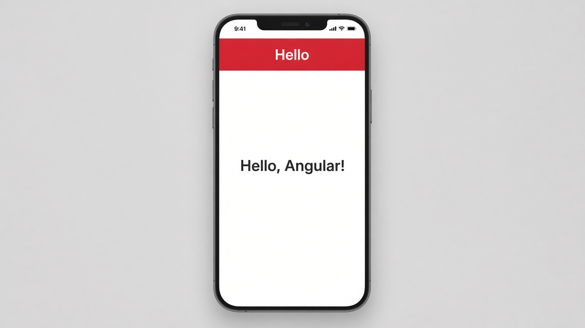

# Components: @Component, selector, and template

Almost every Angular screen starts as a **component**. A component is a class plus an HTML template, tied together with `@Component`. The `selector` is the custom tag you drop into a page; the `template` is what that tag draws.

```typescript
@Component({
  selector: 'app-hello',
  template: `
    <h1>Hello, Angular!</h1>
  `,
})
export class HelloComponent {}
```

## On screen

A red top bar titled “Hello,” and under it “Hello, Angular!” sitting in the middle of a white page — the template rendered as real UI.


