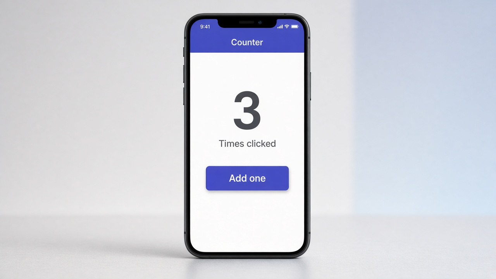

# Event binding with (click)

Event binding is how your template tells the component “the user just did something.” Wrap a DOM event name in parentheses, like `(click)`, and point it at a method on the class. When the button is tapped, Angular calls that method so you can update state.

```typescript
// counter.component.ts
export class CounterComponent {
  count = 0;
  addOne() {
    this.count++;
  }
}
```

```html
<!-- counter.component.html -->
<p>{{ count }}</p>
<button (click)="addOne()">Add one</button>
```

## On screen

On screen you see the count, starting at 0, and an “Add one” button. Each tap runs `addOne()`, which adds one to `count`, and the number on screen updates right away. In the mockup it reads 3 after a few taps.


