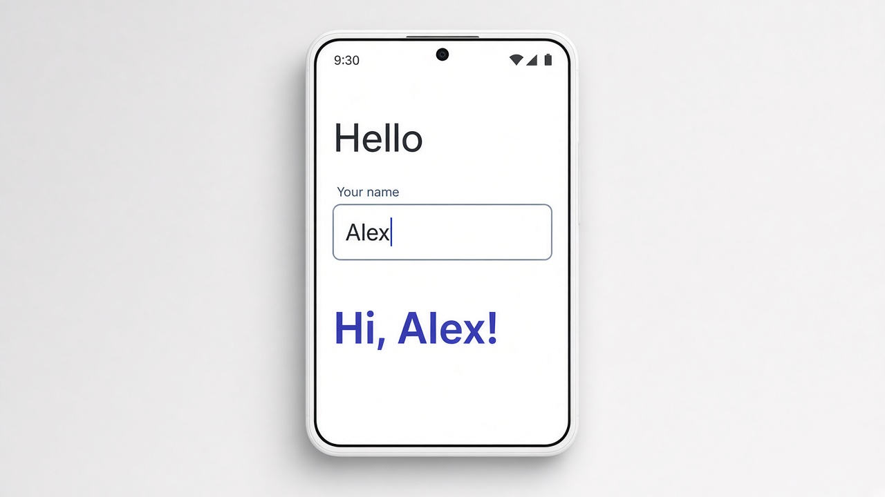

# Two-way binding with [(ngModel)]

Two-way binding with `[(ngModel)]` keeps an input and a component property in sync in both directions. When you type, the property updates, and when the property changes, the input does too. It replaces wiring up a separate property binding and event binding yourself. Angular devs call the syntax "banana in a box" because the parentheses sit inside the square brackets.

```typescript
// app.component.ts
export class AppComponent {
  name = '';
}
```

```html
<!-- app.component.html (needs FormsModule imported) -->
<input [(ngModel)]="name" placeholder="Your name" />
<p>Hi, {{ name }}!</p>
```

## On screen

On screen you see a name field. As you type "Alex," the greeting under it changes to "Hi, Alex!" letter by letter, like in the mockup.


