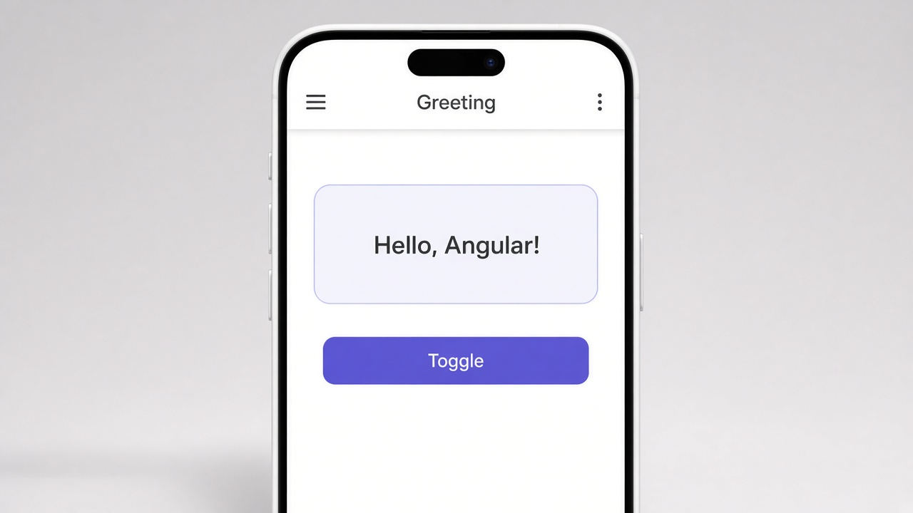

# Control flow: @if and @else

Use `@if` to show or hide part of your UI. Some things should only appear some of the time, like a greeting, an error message, or a menu for logged-in users. Wrap them in `@if` and Angular leaves that block out of the page until the condition is true. Add `@else` if you want something shown the rest of the time.

```typescript
showGreeting = true;
```

```html
@if (showGreeting) {
  <p class="greeting">Hello, Angular!</p>
}
<button (click)="showGreeting = !showGreeting">Toggle</button>
```

## On screen

On screen you'd see a soft card that says "Hello, Angular!" with a purple Toggle button under it. Tap Toggle and the greeting disappears, then tap it again to bring it back. It all happens in the same template, so you don't need any extra components.


