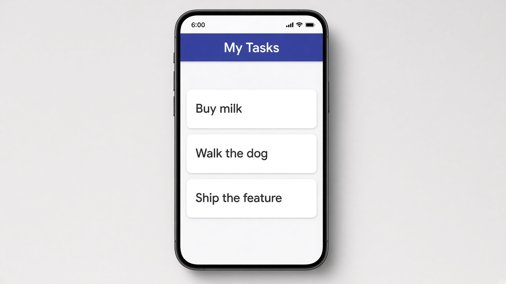

# Control flow: @for with track

Use `@for` to build a list from an array. When several items should look the same, write the markup once inside `@for` and Angular creates one copy for each item in the array. The `track` part gives Angular a way to tell items apart so it updates only the rows that changed. You'll also see the older `*ngFor` syntax in a lot of existing code, and it does the same job.

```typescript
tasks = ['Buy milk', 'Walk the dog', 'Ship the feature'];
```

```html
<ul>
  @for (task of tasks; track task) {
    <li>{{ task }}</li>
  }
</ul>
```

## On screen

On screen you'd see three list rows: "Buy milk", "Walk the dog", and "Ship the feature", one for each string in `tasks`. Add an item to the array or remove one, and the list on screen changes to match.


