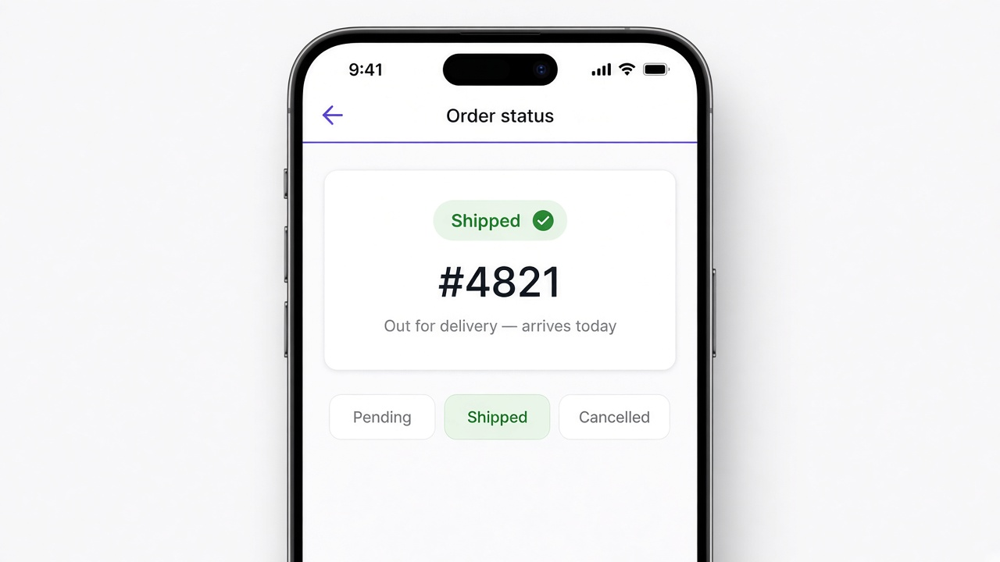

# Control flow: @switch

Use `@switch` to pick one view out of several. After `@if` and `@for`, this is Angular's built-in way to show exactly one block based on a single value, like an order's status, so you don't need a long chain of `@if`s. Angular shows the `@case` that matches, and `@default` covers any value you didn't list.

```html
@switch (status) {
  @case ('pending') { <span class="badge muted">Pending</span> }
  @case ('shipped') { <span class="badge ok">Shipped</span> }
  @case ('cancelled') { <span class="badge bad">Cancelled</span> }
  @default { <span class="badge">Unknown</span> }
}
```

## On screen

On screen you'd see a clean order card for `#4821` with a green Shipped badge and the line "Out for delivery — arrives today." Below it are Pending, Shipped, and Cancelled chips, with Shipped highlighted.


