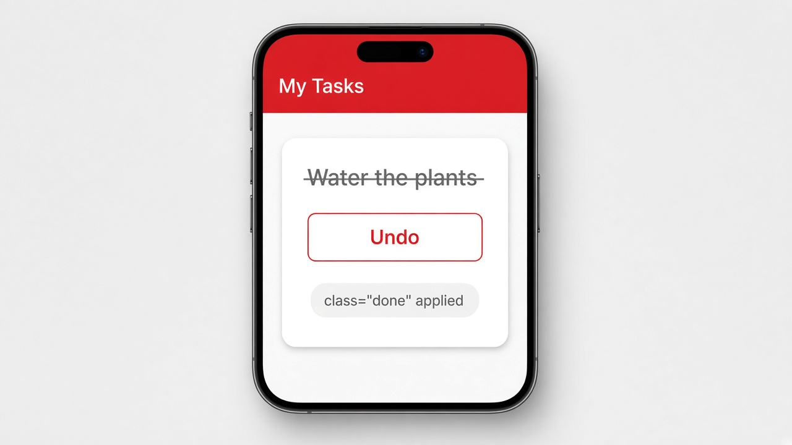

# Class binding with [class.name]

Class binding lets you turn a CSS class on or off from a condition. Write `[class.name]="condition"`, and Angular adds that class when the condition is true and removes it when it's false. You don't need to build class strings by hand or touch the DOM yourself.

```ts
@Component({
  selector: 'app-task',
  template: `
    <p [class.done]="isDone">Water the plants</p>
    <button (click)="isDone = !isDone">
      {{ isDone ? 'Undo' : 'Mark done' }}
    </button>
  `,
  styles: `.done { text-decoration: line-through; color: #9e9e9e; }`
})
export class TaskComponent {
  isDone = false;
}
```

## On screen

At first you'll see "Water the plants" in normal text with a "Mark done" button under it. Tap the button and the text turns gray with a line through it, and the button changes to "Undo." Tap again and everything goes back. If you need several classes at once, `[ngClass]="{ done: isDone, urgent: isUrgent }"` takes an object of class names and conditions.


