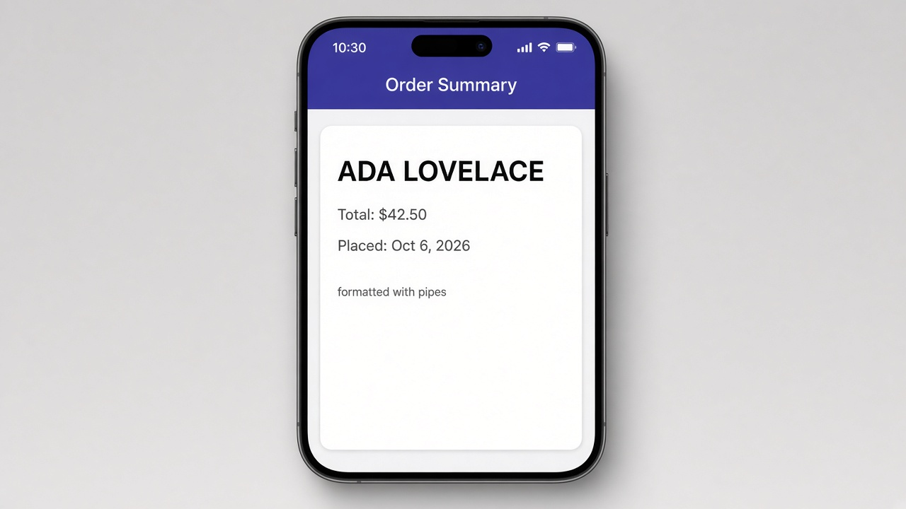

# Pipes

Pipes format a value right in the template, so your component can hold on to the raw data. Write the value, then a `|`, then the pipe name. Some pipes take options after a colon, like `currency:'USD'` or `date:'MMM d, y'`. In a standalone component, add each pipe to `imports` before you use it.

```ts
import { Component } from '@angular/core';
import { CurrencyPipe, DatePipe, UpperCasePipe } from '@angular/common';

@Component({
  selector: 'app-order',
  imports: [UpperCasePipe, CurrencyPipe, DatePipe],
  template: `
    <h2>{{ customer | uppercase }}</h2>
    <p>Total: {{ total | currency:'USD' }}</p>
    <p>Placed: {{ placed | date:'MMM d, y' }}</p>
  `
})
export class OrderComponent {
  customer = 'ada lovelace';
  total = 42.5;
  placed = new Date(2026, 9, 6);
}
```

## On screen

On screen you'd see a card with "ADA LOVELACE" in bold, then "Total: $42.50" and "Placed: Oct 6, 2026." The component still holds the plain values `'ada lovelace'`, `42.5`, and a `Date`, and only what's displayed gets formatted. You can also chain pipes, like `{{ placed | date | uppercase }}`.


