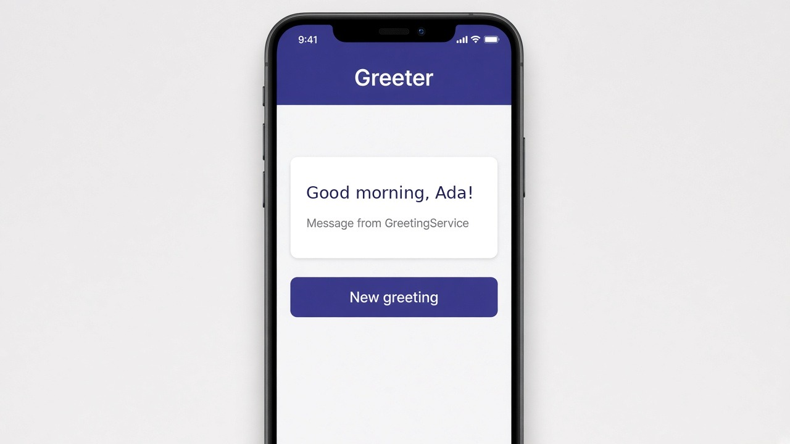

# Services and inject()

Put shared logic in a service and pull it into a component with `inject()`. Your component should mostly handle what goes on screen, and things like fetching data, keeping state, or building messages belong in a service. Mark the class with `@Injectable({ providedIn: 'root' })` and Angular creates one copy for the whole app. Any component that calls `inject(GreetingService)` gets that same copy, and you never write `new` yourself.

```ts
@Injectable({ providedIn: 'root' })
export class GreetingService {
  private greetings = ['Good morning', 'Hey there', 'Welcome back'];
  random(name: string) {
    const g = this.greetings[Math.floor(Math.random() * this.greetings.length)];
    return `${g}, ${name}!`;
  }
}

@Component({
  selector: 'app-greeter',
  standalone: true,
  template: `
    <h2>{{ message }}</h2>
    <button (click)="refresh()">New greeting</button>
  `,
})
export class GreeterComponent {
  private greeter = inject(GreetingService);
  message = this.greeter.random('Ada');
  refresh() { this.message = this.greeter.random('Ada'); }
}
```

## On screen

You'd see a card with a greeting like "Good morning, Ada!" and a "New greeting" button under it. Each tap asks the service for a new line. Older code writes `constructor(private greeter: GreetingService) {}`, which does exactly the same thing; `inject()` is just the newer, shorter way.


