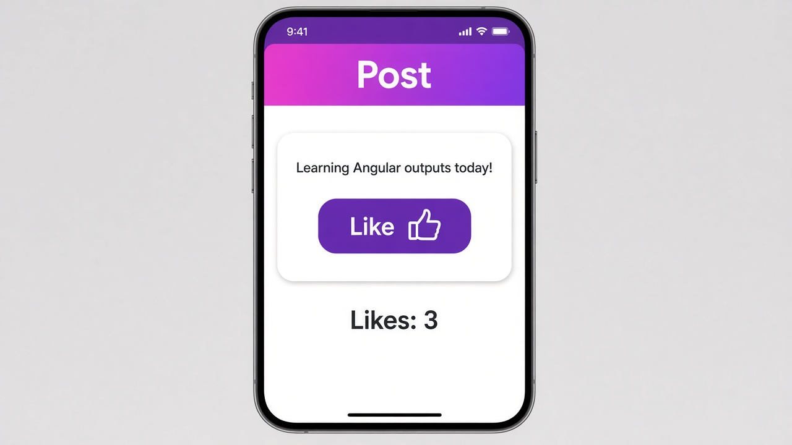

# Outputs with output()

Yesterday, data flowed down from parent to child with `input()`. Today it flows back up with `output()`. A child component declares an `output()` and calls `.emit()` when something happens. The parent listens with the same parentheses syntax you'd use for `(click)`.

```ts
// like-button.ts
@Component({
  selector: 'app-like-button',
  template: `<button (click)="liked.emit()">Like 👍</button>`,
})
export class LikeButton {
  liked = output<void>();
}
```

```html
<!-- parent template -->
<app-like-button (liked)="count = count + 1" />
<p>Likes: {{ count }}</p>
```

## On screen

On screen you'd see a purple Like button with "Likes: 0" under it, and each tap adds one. The button doesn't know anything about counting. It only announces that it was liked, and the parent decides what to do about it. To send data along, give the output a type, like `output<string>()`, and read the value in the parent as `$event`. In older code you'll see `@Output() liked = new EventEmitter<void>()`, which does the same job.


