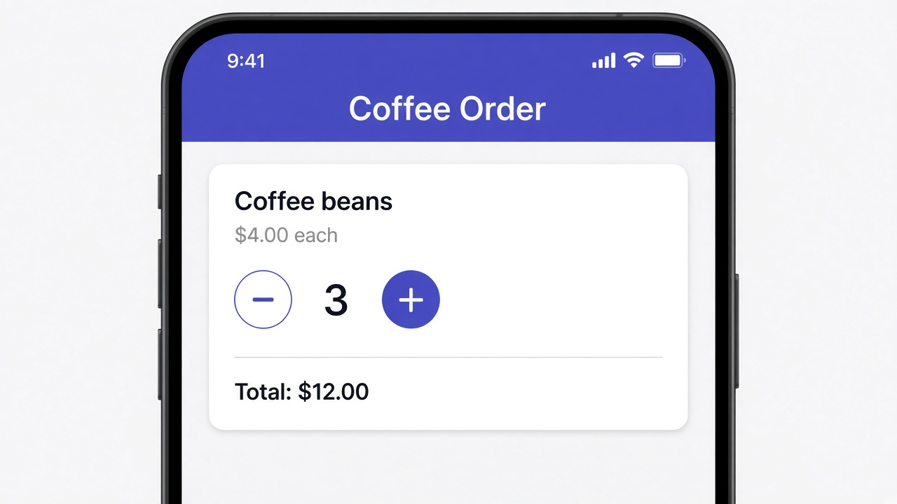

# Signals: signal() and computed()

A signal is a value Angular keeps track of. Create one with `signal(1)`, read it by calling it like a function (`quantity()`), and change it with `set()` or `update()`. The really useful piece is `computed()`. You give it a formula that uses other signals, and it recalculates whenever any of them change, so you never have to remember to update a total by hand.

```ts
import { Component, signal, computed } from '@angular/core';
import { CurrencyPipe } from '@angular/common';

@Component({
  selector: 'app-coffee-order',
  imports: [CurrencyPipe],
  template: `
    <h3>Coffee beans</h3>
    <p>{{ price | currency:'USD' }} each</p>
    <button (click)="quantity.update(q => q - 1)" [disabled]="quantity() === 1">−</button>
    <span>{{ quantity() }}</span>
    <button (click)="quantity.update(q => q + 1)">+</button>
    <p><strong>Total: {{ total() | currency:'USD' }}</strong></p>
  `,
})
export class CoffeeOrder {
  price = 4;
  quantity = signal(1);
  total = computed(() => this.quantity() * this.price);
}
```

## On screen

On screen you'd see a coffee order card at $4.00 each, with a minus button, the quantity, and a plus button. Tap + twice and the quantity goes to 3 while the total changes to $12.00 by itself. The minus button grays out at 1, so you can't order zero. One thing that trips people up is that the template uses `quantity()` with parentheses, not plain `quantity`, because you have to call a signal to get its value.


