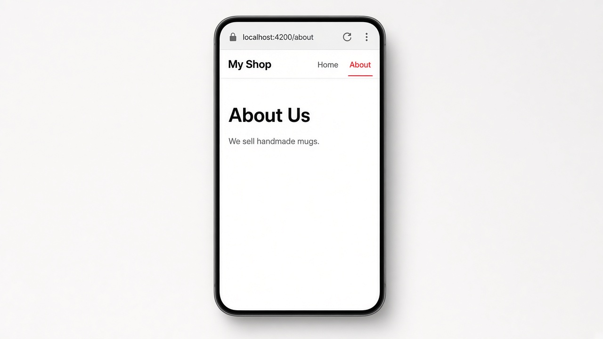

# Routing Basics: Moving Between Pages with the Angular Router

Today we're learning **routing**, which is how one Angular app shows different "pages" without a full page reload. You list your routes as simple path-to-component pairs, hand them to `provideRouter()`, and drop a `<router-outlet />` where you want the current page to appear. Angular swaps the component inside that outlet whenever the URL changes.

To move around, use `routerLink` instead of a plain `href`, so the router handles the click and the app never reloads. Add `routerLinkActive` and Angular puts a class on whichever link matches the current URL, which makes highlighting the active tab easy. (Older apps set this up with `RouterModule.forRoot(routes)` inside an NgModule; `provideRouter()` is the modern standalone way.)

## Code

```ts
// app.routes.ts
export const routes: Routes = [
  { path: '', component: HomeComponent },
  { path: 'about', component: AboutComponent },
];

// main.ts
bootstrapApplication(AppComponent, {
  providers: [provideRouter(routes)],
});

// app.component.ts
@Component({
  selector: 'app-root',
  imports: [RouterOutlet, RouterLink, RouterLinkActive],
  template: `
    <nav>
      <a routerLink="/" routerLinkActive="active"
         [routerLinkActiveOptions]="{ exact: true }">Home</a>
      <a routerLink="/about" routerLinkActive="active">About</a>
    </nav>
    <router-outlet />
  `,
})
export class AppComponent {}
```

## On screen

A "My Shop" nav bar sits at the top with Home and About links. Tap About and the URL changes to `/about`, the About link turns red and underlined, and the area below shows "About Us" with "We sell handmade mugs." The page never reloads; only the content under the nav changes.


