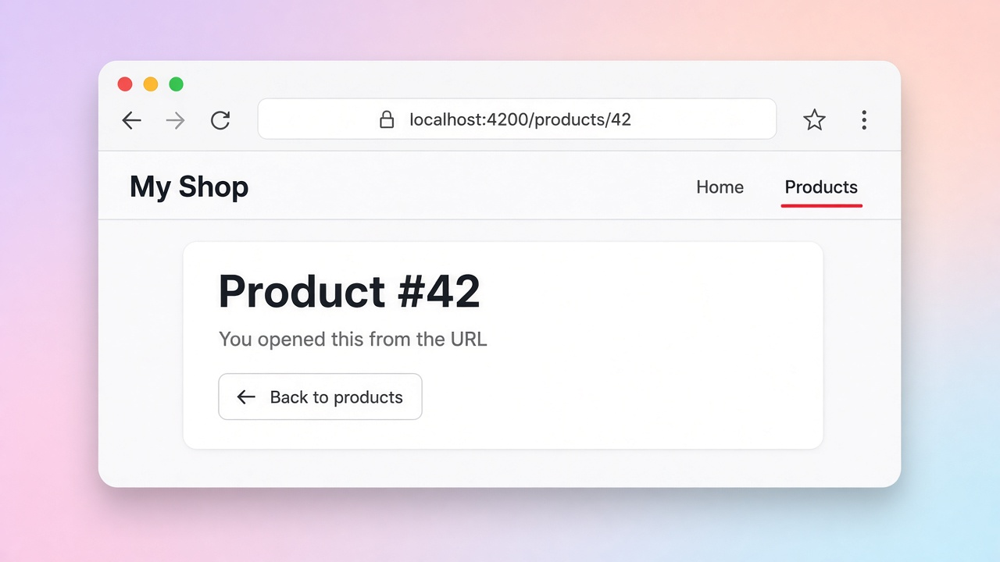

# Route parameters: reading values from the URL

Yesterday we set up routes; today we make them dynamic with **route parameters**. Putting `:id` in a path, like `products/:id`, tells the router "anything in this spot is a value I want." So `/products/42` and `/products/7` both open the same `ProductDetail` component, just with a different `id`.

The modern way to read it is lovely: turn on `withComponentInputBinding()` in `provideRouter()`, and the router hands the parameter straight to a component `input()` with the same name. No subscriptions, no extra service. You'll still see the older style a lot, `inject(ActivatedRoute).snapshot.paramMap.get('id')`, which does the same job by hand.

## Code

```ts
// app.routes.ts
export const routes: Routes = [
  { path: 'products/:id', component: ProductDetail },
];

// main.ts
bootstrapApplication(App, {
  providers: [provideRouter(routes, withComponentInputBinding())],
});

// product-detail.ts
@Component({
  selector: 'app-product-detail',
  imports: [RouterLink],
  template: `
    <h2>Product #{{ id() }}</h2>
    <p>You opened this from the URL</p>
    <a routerLink="/products">← Back to products</a>
  `,
})
export class ProductDetail {
  id = input.required<string>(); // filled from :id
}
```

```html
<!-- linking to it -->
<a [routerLink]="['/products', 42]">View product 42</a>
```

## On screen

The address bar shows `localhost:4200/products/42`, and under the "My Shop" nav (with Products highlighted) a card reads "Product #42" with a "← Back to products" link. Change the URL to `/products/7` and the heading switches to "Product #7".


