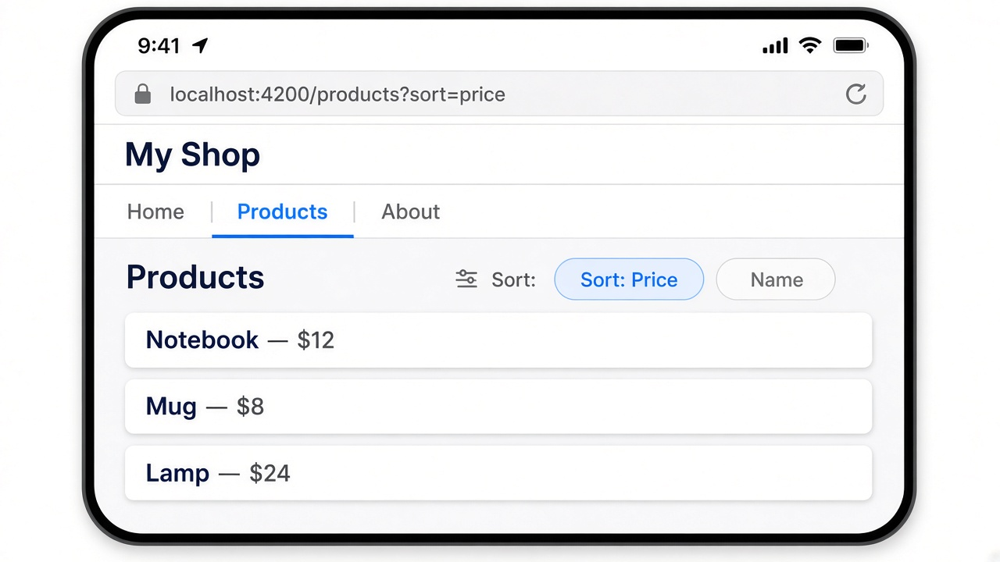

# Query parameters: filters that live in the URL

Route parameters name a specific page (`/products/42`). **Query parameters** sit after a `?` and tweak that page without changing which component loads — think filters, sort order, or a search box. So `/products?sort=price` and `/products?sort=name` both open `ProductList`, just with a different `sort` value the user (and a bookmark) can share.

With `withComponentInputBinding()` already on (from yesterday), an `input()` whose name matches the query key gets filled automatically. Tap a sort chip and `[queryParams]` on `routerLink` updates the URL; the input refreshes and your list reorders. The older path is still common: `inject(ActivatedRoute).snapshot.queryParamMap.get('sort')`.

## Code

```ts
// product-list.ts
@Component({
  selector: 'app-product-list',
  imports: [RouterLink],
  template: `
    <h2>Products</h2>
    <div class="sort">
      <a routerLink="/products" [queryParams]="{ sort: 'price' }"
         [class.active]="sort() === 'price'">Sort: Price</a>
      <a routerLink="/products" [queryParams]="{ sort: 'name' }"
         [class.active]="sort() === 'name'">Name</a>
    </div>
    @for (p of sorted(); track p.name) {
      <div class="card">{{ p.name }} — ${{ p.price }}</div>
    }
  `,
})
export class ProductList {
  // filled from ?sort=… via withComponentInputBinding()
  sort = input('name');

  private items = [
    { name: 'Notebook', price: 12 },
    { name: 'Mug', price: 8 },
    { name: 'Lamp', price: 24 },
  ];

  sorted = computed(() => {
    const list = [...this.items];
    return this.sort() === 'price'
      ? list.sort((a, b) => a.price - b.price)
      : list.sort((a, b) => a.name.localeCompare(b.name));
  });
}
```

## On screen

The address bar shows `localhost:4200/products?sort=price`. Under the "My Shop" nav (Products highlighted), a "Sort: Price" chip is active next to "Name", and three product cards list Notebook, Mug, and Lamp. Switch the chip to Name and the URL becomes `?sort=name` while the cards reorder alphabetically.


