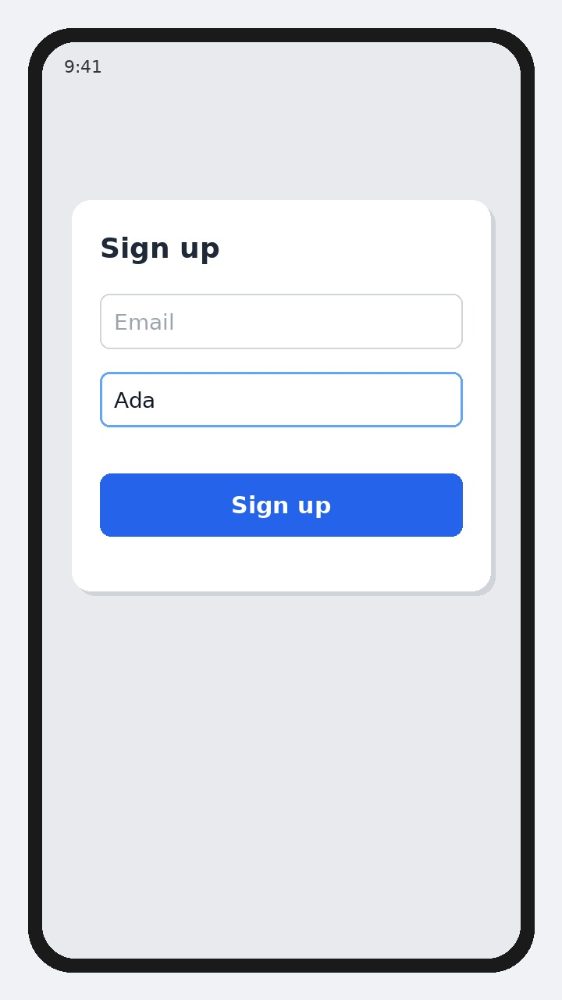

# FormGroup and Validators

Good morning! Yesterday we met a single `FormControl`. Today we bundle several of them into a **FormGroup** and add **Validators** so Angular can tell you when a field is empty or too short. Wrap the fields in a `[formGroup]` form, bind each input with `formControlName`, and gate the submit button with `form.invalid`. Built-in helpers like `Validators.required` and `Validators.minLength(3)` sit on each control; older apps often build the same group with `FormBuilder`, which is just shorter syntax for the same idea.

```ts
import { Component } from '@angular/core';
import { FormControl, FormGroup, ReactiveFormsModule, Validators } from '@angular/forms';

@Component({
  selector: 'app-signup',
  imports: [ReactiveFormsModule],
  template: `
    <form [formGroup]="form" (ngSubmit)="submit()">
      <input formControlName="email" placeholder="Email">
      <input formControlName="name" placeholder="Name">
      <button [disabled]="form.invalid">Sign up</button>
    </form>
  `,
})
export class Signup {
  form = new FormGroup({
    email: new FormControl('', Validators.required),
    name: new FormControl('', [Validators.required, Validators.minLength(3)]),
  });

  submit() {
    console.log(this.form.value);
  }
}
```

## On screen

A Sign up form with Email and Name fields. The Sign up button stays disabled until email is filled and the name is at least three characters; once both look valid, the button lights up and submitting logs the form values.


