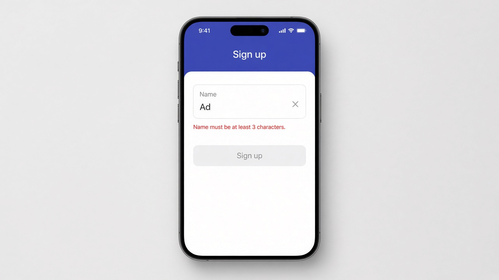

# Showing Validation Error Messages

Good morning! Yesterday our Sign up button knew when the form was invalid, but the user had no idea why. Today we show **validation error messages** right under the field. Grab the control with `form.controls.name`, then use `@if` to show a message when it has a specific error, like `hasError('minlength')`. Checking `touched` too means the message only shows up after the user leaves the field, so nobody gets scolded before they've typed a thing. Older templates did the same job with `*ngIf` and `form.get('name')?.errors?.['minlength']`.

```ts
@Component({
  selector: 'app-signup',
  imports: [ReactiveFormsModule],
  template: `
    <form [formGroup]="form">
      <input formControlName="name" placeholder="Name">
      @if (name.touched && name.hasError('required')) {
        <p class="error">Name is required.</p>
      }
      @if (name.touched && name.hasError('minlength')) {
        <p class="error">Name must be at least 3 characters.</p>
      }
      <button [disabled]="form.invalid">Sign up</button>
    </form>
  `,
  styles: `.error { color: #c62828; font-size: 0.85rem; }`,
})
export class Signup {
  form = new FormGroup({
    name: new FormControl('', [Validators.required, Validators.minLength(3)]),
  });
  name = this.form.controls.name;
}
```

## On screen

A Sign up form with a Name field. Type "Ad", tap away, and a small red line appears underneath saying "Name must be at least 3 characters." Clear the field and it switches to "Name is required." Type a third letter and the message disappears and the Sign up button lights up.


