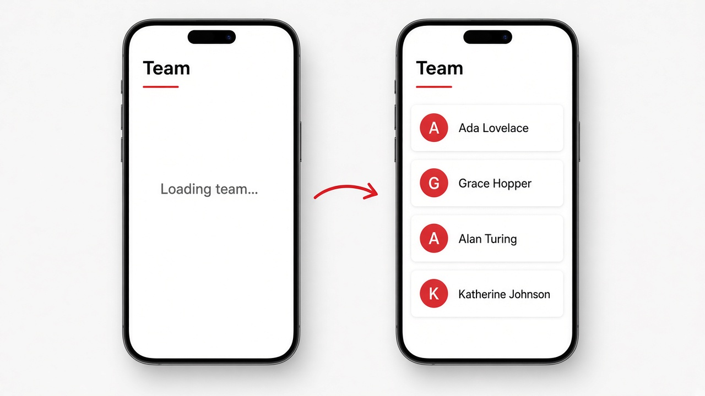

# Fetching Data with HttpClient

Good morning! So far every list we've shown lived right inside the component. Real apps get their data from a server, and Angular's tool for that is **HttpClient**. Turn it on once with `provideHttpClient()` in `bootstrapApplication`, then grab it in any component with `inject(HttpClient)` and call `http.get<User[]>(url)`. That call hands back an Observable, a value that arrives later, so wrap it in `toSignal()` and you can read it in the template like any other signal: `users()`. Until the response lands, `initialValue: []` keeps the list empty, and `@for`'s `@empty` block shows a friendly "Loading team..." line. You'll still see the older style a lot: `HttpClientModule` in an NgModule, and either `.subscribe()` in the component or the `| async` pipe in the template.

```ts
// main.ts
bootstrapApplication(App, {
  providers: [provideHttpClient()],
});

// team.ts
interface User { id: number; name: string; }

@Component({
  selector: 'app-team',
  template: `
    <h2>Team</h2>
    @for (user of users(); track user.id) {
      <p>{{ user.name }}</p>
    } @empty {
      <p>Loading team...</p>
    }
  `,
})
export class Team {
  private http = inject(HttpClient);
  users = toSignal(this.http.get<User[]>('/api/users'), { initialValue: [] });
}
```

`HttpClient` and `provideHttpClient` come from `@angular/common/http`, and `toSignal` comes from `@angular/core/rxjs-interop`.

## On screen

A page titled "Team" briefly shows "Loading team..." and then, a moment later, fills in with one row per person from the server: Ada Lovelace, Grace Hopper, Alan Turing, and Katherine Johnson. You never told the template to refresh; the signal updated when the data arrived and the list redrew itself.


