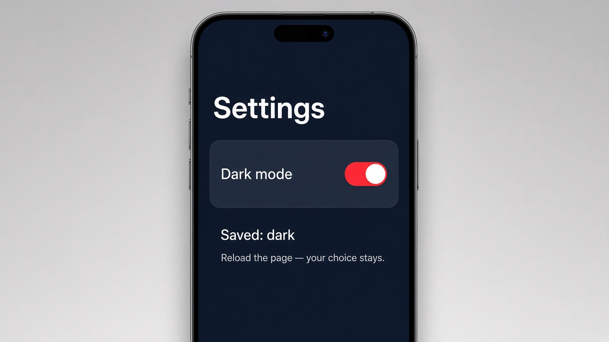

# Running side effects with effect()

Today's tip is **`effect()`**, the signal tool for doing something *outside* your template whenever a signal changes. You already know `computed()` builds a new value from other signals. `effect()` is its cousin for side effects: saving to `localStorage`, logging, or poking the DOM. You give it a function, Angular notes which signals that function reads, and it runs again on its own every time one of them changes. No subscribe, no manual call in every click handler.

A good rule of thumb: if you're calculating a value to show, use `computed()`. If you're reaching out to the world (storage, the page, an analytics call), use `effect()`. Create it in the constructor (or a field initializer), because it needs Angular's injection context. Before signals, you'd do this by hand inside each event handler, or with an RxJS `.subscribe()` or the `ngOnChanges` lifecycle hook.

## Code

```ts
import { Component, signal, effect } from '@angular/core';

@Component({
  selector: 'app-settings',
  template: `
    <h1>Settings</h1>
    <label class="toggle">
      Dark mode
      <input type="checkbox" [checked]="dark()" (change)="dark.set(!dark())" />
    </label>
    <p>Saved: {{ dark() ? 'dark' : 'light' }}</p>
    <small>Reload the page — your choice stays.</small>
  `,
})
export class Settings {
  dark = signal(localStorage.getItem('theme') === 'dark');

  constructor() {
    effect(() => {
      localStorage.setItem('theme', this.dark() ? 'dark' : 'light');
      document.body.classList.toggle('dark', this.dark());
    });
  }
}
```

## On screen

A Settings page with a "Dark mode" switch. Flip it on and the whole page turns dark navy (thanks to a `body.dark` rule in your global styles), and the caption below changes to "Saved: dark". Reload the browser and the switch is still on, because the effect quietly wrote your choice to `localStorage` the moment the signal changed.


