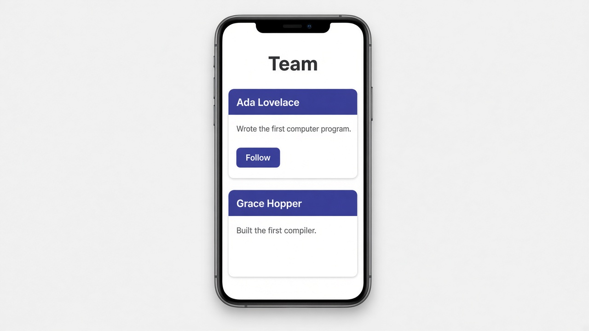

# Reusable wrappers with content projection (<ng-content>)

Today's tip is **content projection**, Angular's way of letting a component wrap whatever HTML you put between its tags. Inputs are great for passing *values* into a child, but sometimes you want to pass in *markup*: a heading, a paragraph, a button. Drop an `<ng-content />` into the child's template and Angular slots the parent's content right there. That's how you build one `Card`, `Dialog`, or `Panel` and reuse it everywhere with different insides.

You can also have more than one slot. `<ng-content select="[card-title]" />` grabs only the elements marked with a `card-title` attribute, and a plain `<ng-content />` catches everything else. One thing to remember: the projected content still belongs to the parent, so its bindings and click handlers use the parent's properties. In older code you'll see `<ng-content></ng-content>` with a closing tag; the self-closing form does the same thing.

## Code

```ts
import { Component } from '@angular/core';

@Component({
  selector: 'app-card',
  template: `
    <div class="card">
      <header><ng-content select="[card-title]" /></header>
      <ng-content />
    </div>
  `,
  styles: `
    .card { border: 1px solid #ddd; border-radius: 8px; box-shadow: 0 2px 6px #0002; margin-bottom: 1rem; }
    header { background: indigo; color: white; padding: 0.5rem 1rem; }
  `,
})
export class Card {}
```

```html
<!-- team.html (Card is in the parent's imports) -->
<h1>Team</h1>
<app-card>
  <h2 card-title>Ada Lovelace</h2>
  <p>Wrote the first computer program.</p>
  <button>Follow</button>
</app-card>
<app-card>
  <h2 card-title>Grace Hopper</h2>
  <p>Built the first compiler.</p>
</app-card>
```

## On screen

A "Team" page with two matching white cards. Each one has an indigo title bar on top ("Ada Lovelace", then "Grace Hopper") with a short line of text underneath. Only Ada's card has a "Follow" button, because that's the only one you put a button into. Same border, padding, and shadow on both, since they're the same `Card` component with different content projected inside.


