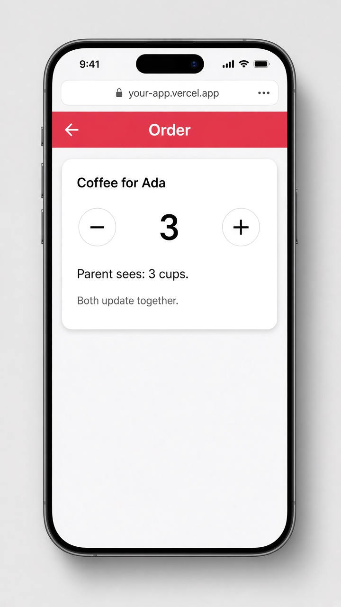

# Two-way binding between components with model()

Today's tip is **`model()`**, the modern way to give your own component two-way binding. You already know `input()` passes data down and `output()` sends events up. `model()` does both in one line: the child gets a writable signal, and when it changes the value, the parent's signal updates too. In the parent you use the familiar "banana in a box" syntax, `[(count)]="cups"`, just like `[(ngModel)]` on a form field.

It's perfect for small reusable controls like steppers, toggles, and rating stars. Before `model()` you'd write an `@Input() count` plus an `@Output() countChange = new EventEmitter<number>()` pair. That older pattern still works, and `model()` is just the shorter, signal-based version of it.

```ts
// stepper.component.ts
import { Component, model } from '@angular/core';

@Component({
  selector: 'app-stepper',
  template: `
    <button (click)="count.update(c => c - 1)">−</button>
    <span>{{ count() }}</span>
    <button (click)="count.update(c => c + 1)">+</button>
  `,
})
export class Stepper {
  count = model(1);
}
```

```html
<!-- order.component.html (parent, with cups = signal(3)) -->
<h2>Coffee for Ada</h2>
<app-stepper [(count)]="cups" />
<p>Parent sees: {{ cups() }} cups</p>
```

## On screen

An "Order" page with a card titled "Coffee for Ada". It holds a stepper with a − button, a big **3**, and a + button. Under it, "Parent sees: 3 cups." Tap + and both the stepper and the parent's line jump to 4 at the same time.


