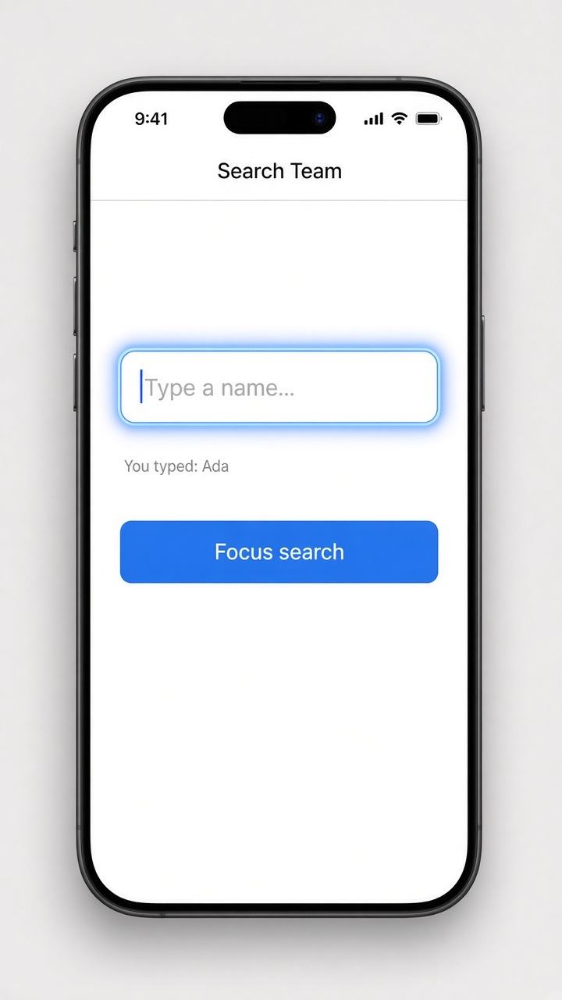

# Template reference variables and viewChild()

Today's tip is about **template reference variables**. Put `#box` on any element in your template and you get a name for it right there in the HTML, so you can pass it to a method like `save(box)` without wiring up a property first. It's the quickest way to grab what someone typed.

When the class needs the element too, say to put the cursor in the field, ask for it with **`viewChild()`**. It returns a signal, so you read it with `this.box()` and reach the real DOM node through `.nativeElement`. The older style is the `@ViewChild('box') box!: ElementRef;` decorator, which you'll still see in lots of code and which does the same job.

```ts
import { Component, ElementRef, signal, viewChild } from '@angular/core';

@Component({
  selector: 'app-search',
  template: `
    <input #box placeholder="Type a name..." (keyup.enter)="save(box)" />
    <p>You typed: {{ last() }}</p>
    <button (click)="focusSearch()">Focus search</button>
  `,
})
export class Search {
  last = signal('');
  box = viewChild.required<ElementRef<HTMLInputElement>>('box');

  save(input: HTMLInputElement) {
    this.last.set(input.value);
    input.value = '';
  }

  focusSearch() {
    this.box().nativeElement.focus();
  }
}
```

## On screen

A "Search Team" page with one text field and a blue **Focus search** button. Type Ada and press Enter: the field clears and the line under it reads "You typed: Ada". Tap the button and the cursor jumps straight back into the field, which lights up with a blue focus glow, ready for the next name.


