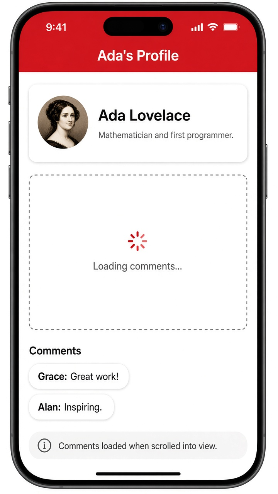

# Lazy loading with @defer

Today's tip is about **`@defer` blocks**. Some parts of a page are heavy but not urgent, like a comments section at the bottom of a profile. Wrap that part in `@defer` and Angular splits it into its own chunk, downloading and rendering it only when it's needed. With `on viewport`, that's the moment the block scrolls into view, so the top of the page shows up faster.

`@defer` comes with helper blocks: `@placeholder` shows before loading starts, and `@loading` shows while the chunk is downloading (`minimum 500ms` keeps a spinner from flashing). Other triggers include `on idle` (the default), `on interaction`, and `on timer(2s)`. One rule: the components inside must be standalone and not referenced anywhere else in the file, or Angular can't split them out. Before `@defer`, you'd do this with lazy-loaded routes or a manual dynamic `import()`.

```ts
@Component({
  selector: 'app-profile',
  imports: [Comments],
  template: `
    <h1>Ada's Profile</h1>
    <p>Ada Lovelace, mathematician and first programmer.</p>

    @defer (on viewport) {
      <app-comments />
    } @placeholder {
      <div class="box">Comments below...</div>
    } @loading (minimum 500ms) {
      <div class="box">Loading comments...</div>
    }
  `,
})
export class Profile {}
```

## On screen

A phone with a red "Ada's Profile" header and a card for Ada Lovelace. Below it sits a dashed box with a small spinner and "Loading comments..." as you scroll down. A moment later the Comments section appears with bubbles from Grace ("Great work!") and Alan ("Inspiring."). The comments code was never downloaded until you scrolled to it.


