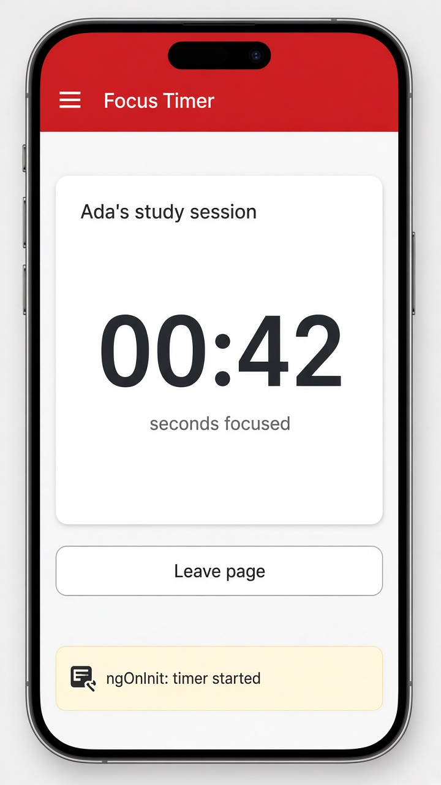

# Lifecycle hooks: ngOnInit and ngOnDestroy

Today's tip is about **lifecycle hooks**, the moments Angular tells your component "you just showed up" and "you're about to leave." The two you'll use most are `ngOnInit`, which runs once after Angular sets the component's inputs, and `ngOnDestroy`, which runs right before the component is removed from the page. `ngOnInit` is the right spot to kick things off (start a timer, load data that needs an input value), and `ngOnDestroy` is where you clean up, so a timer or subscription doesn't keep running after you navigate away.

You opt in by implementing the interface (`OnInit`, `OnDestroy`) and adding the method. Why not just use the constructor? Inputs aren't set yet there, so keep the constructor for `inject()` and simple setup. In newer code you'll also see `inject(DestroyRef).onDestroy(() => ...)`, which registers cleanup without a class method, and signals with `effect()` cover a lot of what `ngOnChanges` used to do.

```ts
@Component({
  selector: 'app-focus-timer',
  template: `
    <h2>Ada's study session</h2>
    <p class="big">{{ seconds() }}</p>
    <p>seconds focused</p>
  `,
})
export class FocusTimer implements OnInit, OnDestroy {
  seconds = signal(0);
  private id?: ReturnType<typeof setInterval>;

  ngOnInit() {
    console.log('ngOnInit: timer started');
    this.id = setInterval(() => this.seconds.update(s => s + 1), 1000);
  }

  ngOnDestroy() {
    clearInterval(this.id);
    console.log('ngOnDestroy: timer stopped');
  }
}
```

## On screen

A phone with a red "Focus Timer" header and a white card titled "Ada's study session," showing a big counter (00:42) that ticks up every second, with "seconds focused" underneath. Below it is a "Leave page" button, and a small note reads "ngOnInit: timer started." Tap Leave page and the component is destroyed, `ngOnDestroy` clears the interval, and the console logs "ngOnDestroy: timer stopped" instead of the timer quietly running forever.


