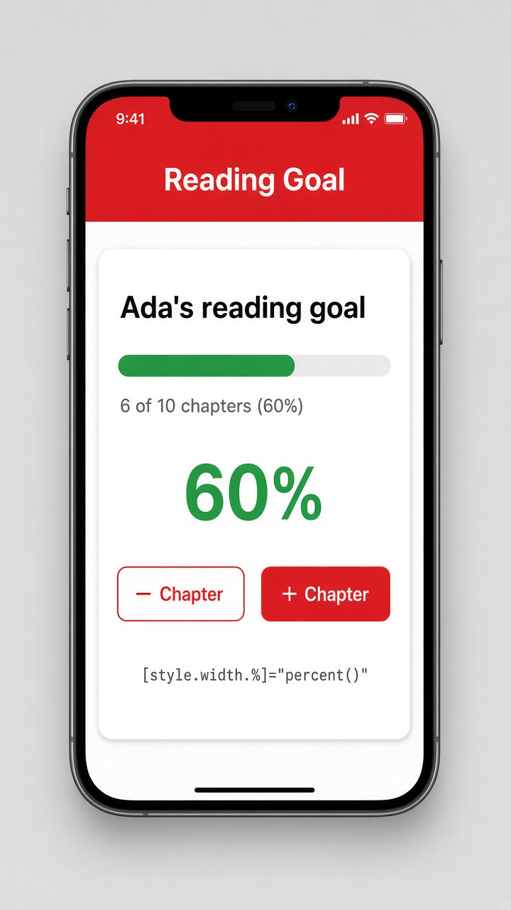

# Style binding: [style.width.%]

Today's tip is **style binding**, which lets a single CSS property follow your data. You write `[style.property]="value"` on an element, and Angular updates that one style whenever the value changes. You can even put the unit right in the binding: `[style.width.%]="percent()"` means "set the width to this many percent," so you pass a plain number and skip building strings like `'60%'` yourself. It's perfect for progress bars, sliders, and colors that depend on state.

Pair it with a signal and `computed()`, and the bar moves on its own every time the count changes. To set several styles at once, bind an object with `[style]="{ color: c, 'font-size.px': 18 }"`. In older code you'll often see `[ngStyle]="{ ... }"`, which still works but needs the `NgStyle` import. Plain `[style]` is the modern choice.

```ts
@Component({
  selector: 'app-reading-goal',
  template: `
    <h2>Ada's reading goal</h2>
    <div class="track">
      <div class="fill"
           [style.width.%]="percent()"
           [style.background]="percent() >= 100 ? 'gold' : 'seagreen'"></div>
    </div>
    <p>{{ read() }} of 10 chapters ({{ percent() }}%)</p>
    <button (click)="read.update(n => Math.max(0, n - 1))">- Chapter</button>
    <button (click)="read.update(n => Math.min(10, n + 1))">+ Chapter</button>
  `,
  styles: `
    .track { background: #ddd; border-radius: 8px; }
    .fill { height: 16px; border-radius: 8px; }
  `,
})
export class ReadingGoal {
  protected Math = Math;
  read = signal(6);
  percent = computed(() => this.read() * 10);
}
```

## On screen

You see "Ada's reading goal" above a gray progress track with a green bar filled 60% of the way, the text "6 of 10 chapters (60%)", and "- Chapter" / "+ Chapter" buttons. Tap "+ Chapter" and the bar grows to 70% right away; tap "-" and it shrinks. Hit 10 chapters and the bar fills completely and turns gold. The mockup also shows a big "60%" readout under a red "Reading Goal" header.


