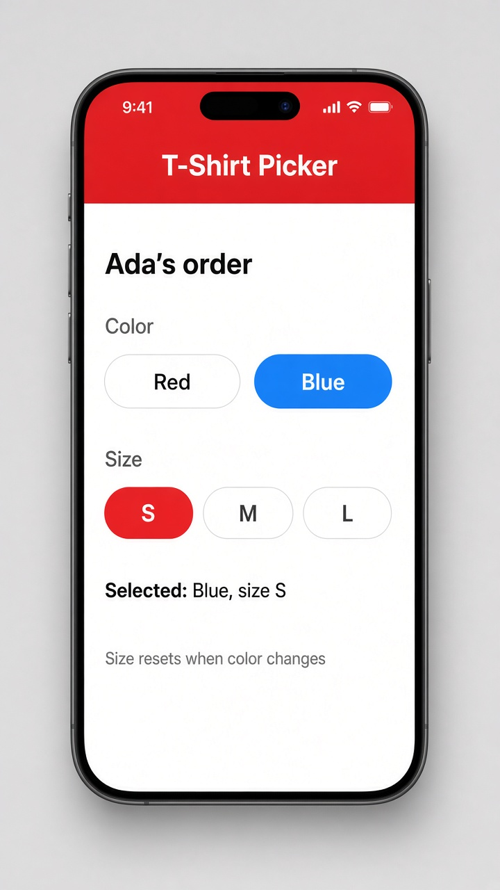

# linkedSignal(): state that resets when its source changes

Today's tip is **`linkedSignal()`**, a signal you can write to like `signal()`, but that also follows another signal like `computed()`. Picture a T-shirt picker: the user chooses a size, but when they switch colors, the list of sizes changes and the old choice may not exist anymore. With `linkedSignal(() => this.sizes()[0])`, the size snaps back to the first available option whenever `sizes()` changes, and in between the user can still `set()` it freely.

Without it, you'd keep a plain `signal()` and write an `effect()` to reset it, which is easy to get wrong. Rule of thumb: `computed()` is read-only and derived, `signal()` is writable and independent, and `linkedSignal()` is writable but resets from a source. There's also a longer form, `linkedSignal({ source, computation })`, that lets you keep the old choice when it's still valid.

```ts
@Component({
  selector: 'app-shirt-picker',
  template: `
    <h2>Ada's order</h2>
    @for (c of colors; track c) {
      <button [class.on]="c === color()" (click)="color.set(c)">{{ c }}</button>
    }
    @for (s of sizes(); track s) {
      <button [class.on]="s === size()" (click)="size.set(s)">{{ s }}</button>
    }
    <p>Selected: {{ color() }}, size {{ size() }}</p>
  `,
})
export class ShirtPicker {
  colors = ['Red', 'Blue'];
  color = signal('Blue');
  sizes = computed(() => (this.color() === 'Red' ? ['M', 'L', 'XL'] : ['S', 'M', 'L']));
  size = linkedSignal(() => this.sizes()[0]); // writable, resets on color change
}
```

## On screen

You see the heading "Ada's order", a row of color buttons (Red and Blue, with Blue highlighted by the `.on` class), a row of size buttons (S, M, and L, with S highlighted), and the line "Selected: Blue, size S". In the mockup, the app around the component adds a red "T-Shirt Picker" header. Tap L and the text changes to "size L". Switch to Red and the sizes become M, L, and XL, and the choice snaps back to M on its own.


