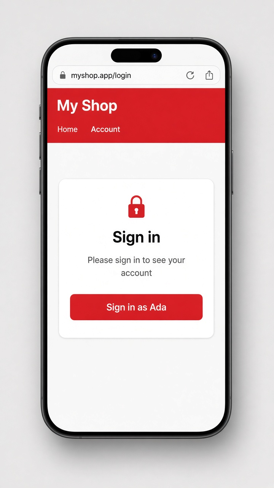

# Route guards: keeping pages behind a sign-in

Today's tip is **route guards**, little functions the router runs before it opens a page. Say your shop has an Account page that only makes sense for signed-in users. Instead of checking inside the component, you attach a guard to the route with `canActivate`. The guard returns `true` to let the user in, or a `UrlTree` (made with `router.createUrlTree()`) to send them somewhere else, like the login page.

Modern guards are just plain functions typed as `CanActivateFn`, and they can call `inject()` to grab services like your `AuthService` and the `Router`. You'll still see older class-based guards that `implements CanActivate` in existing code; they do the same job with more ceremony. There are siblings too: `canDeactivate` (for "you have unsaved changes"), `canMatch`, and `resolve`.

```ts
// auth.guard.ts
export const authGuard: CanActivateFn = () => {
  const auth = inject(AuthService);   // has loggedIn = signal(false)
  const router = inject(Router);
  return auth.loggedIn() ? true : router.createUrlTree(['/login']);
};

// app.routes.ts
export const routes: Routes = [
  { path: 'login', component: Login },
  { path: 'account', component: Account, canActivate: [authGuard] },
];
```

```html
<!-- login.html -->
<h2>Sign in</h2>
<p>Please sign in to see your account</p>
<button (click)="auth.loggedIn.set(true); router.navigate(['/account'])">
  Sign in as Ada
</button>
```

## On screen

When you're signed out and open `/account`, you don't get the Account page. The guard sends you to `/login` instead, which shows the heading "Sign in", the line "Please sign in to see your account", and a "Sign in as Ada" button. In the mockup, the app around it adds a red "My Shop" header with an Account link, and styles the card with a lock icon and a red button. Tap the button and the guard lets you through, so the Account page opens.


