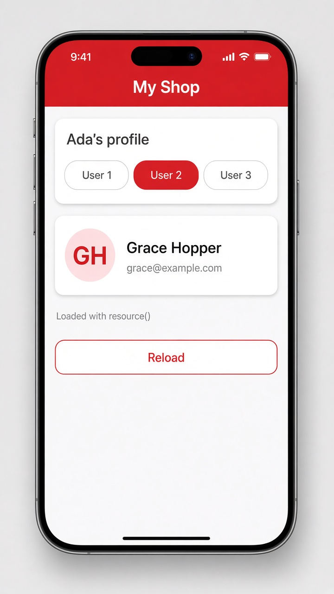

# resource(): loading async data that follows a signal

Today's tip is **`resource()`**, Angular's signal-friendly way to load async data. You give it two things: `params`, a function that reads your signals, and `loader`, an async function that fetches the data. Whenever a signal inside `params` changes, Angular calls the loader again for you and cancels the old request through `abortSignal`. The result comes back as signals too: `value()`, `isLoading()`, `error()`, plus a `reload()` method.

That means no manual subscribe, no "loading" flag you flip by hand, and no stale responses landing after a newer one. If you're already using `HttpClient`, there's a shortcut called `httpResource(() => '/api/users/' + this.userId())`. The older way was calling `HttpClient` in `ngOnInit` (or on every change) and subscribing yourself. Note that `params` was called `request` in Angular 19, so you may see that name in older code.

```ts
// profile.ts
export class Profile {
  userId = signal(2);

  user = resource({
    params: () => ({ id: this.userId() }),
    loader: async ({ params, abortSignal }) => {
      const res = await fetch(`/api/users/${params.id}`, { signal: abortSignal });
      return (await res.json()) as User;
    },
  });
}
```

```html
<!-- profile.html -->
@for (id of [1, 2, 3]; track id) {
  <button (click)="userId.set(id)">User {{ id }}</button>
}

@if (user.isLoading()) {
  <p>Loading...</p>
} @else if (user.value(); as u) {
  <h3>{{ u.name }}</h3>
  <p>{{ u.email }}</p>
}
<button (click)="user.reload()">Reload</button>
```

## On screen

You see a row of buttons, User 1, User 2, and User 3. Tap User 2 and "Loading..." shows for a moment, then the card fills in with "Grace Hopper" and her contact details. Tap another user and the card swaps to that person without any extra code, and the Reload button fetches the same user again. In the mockup, the app around it adds a red "My Shop" header, a highlighted User 2 pill, a "GH" avatar circle, and a small "Loaded with resource()" caption.


