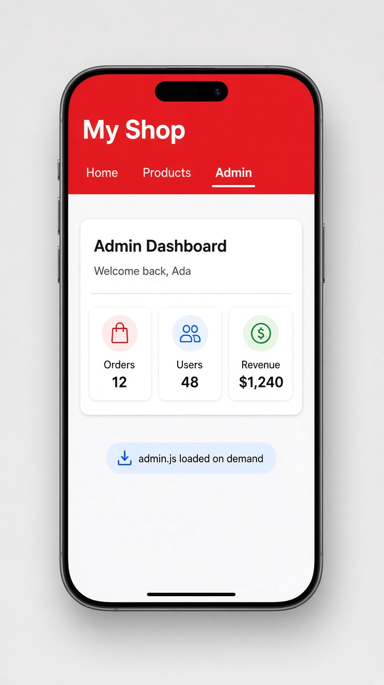

# Lazy loading routes with loadComponent

Today's tip is **lazy loading routes**. Normally every page you list in your routes gets bundled into the first download, even pages most people never open. With `loadComponent`, you hand Angular a tiny function that does a dynamic `import()`, and Angular only downloads that page's code the first time someone navigates there. Your app starts faster, and the admin screen (or settings, or checkout) arrives right when it's needed.

It's one small change per route: swap `component: AdminDashboard` for `loadComponent: () => import(...)`. To lazy load a whole group of routes at once, use `loadChildren` pointing at a file that exports a routes array. The older way was `loadChildren` with an `NgModule` (`.then(m => m.AdminModule)`), which you'll still see in many existing apps.

```ts
// app.routes.ts
export const routes: Routes = [
  { path: '', component: Home },
  { path: 'products', component: Products },
  {
    path: 'admin',
    loadComponent: () =>
      import('./admin/admin-dashboard').then(m => m.AdminDashboard),
  },
  // a whole section at once:
  // { path: 'shop', loadChildren: () => import('./shop/shop.routes').then(m => m.SHOP_ROUTES) },
];
```

```html
<!-- app.html -->
<nav>
  <a routerLink="/">Home</a>
  <a routerLink="/products">Products</a>
  <a routerLink="/admin">Admin</a>
</nav>
<router-outlet />
```

## On screen

The app opens on Home exactly as before, but the admin code hasn't been downloaded yet. Tap Admin and the "Admin Dashboard" card appears with "Welcome back, Ada" and tiles for Orders 12, Users 48, and Revenue $1,240. In your browser's Network tab, a separate admin chunk loads only at that moment. In the mockup, the app adds a red "My Shop" header with the Admin tab underlined and a small "admin.js loaded on demand" badge.


