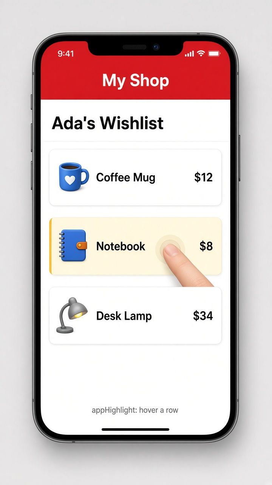

# Custom attribute directives

Today's tip is **custom attribute directives**. A component brings its own template, but a directive is a little bundle of behavior you clip onto an element you already have, just by adding an attribute. Write it once, and any row, card, or button in your app can pick it up, like `<li appHighlight>`. It's a great home for small, reusable touches such as hover highlights, auto-focus, or tooltips.

In modern Angular a directive is standalone, so you just add it to a component's `imports`. The `host` object lets the directive listen to events and bind styles on the element it sits on, and `input()` lets you pass it a value, here the highlight color. You'll still see the older `@HostListener('mouseenter')` and `@HostBinding('style.background')` decorators in lots of code; they do the same job.

```ts
// highlight.ts
import { Directive, input, signal } from '@angular/core';

@Directive({
  selector: '[appHighlight]',
  host: {
    '(mouseenter)': 'on.set(true)',
    '(mouseleave)': 'on.set(false)',
    '[style.background]': "on() ? appHighlight() || '#fff3b0' : ''",
  },
})
export class Highlight {
  appHighlight = input(''); // optional color; a bare attribute passes ''
  on = signal(false);
}
```

```html
<!-- wishlist.html (Highlight is in the component's imports) -->
<h2>Ada's Wishlist</h2>
@for (item of items; track item.name) {
  <div class="row" appHighlight>{{ item.name }} <span>{{ item.price | currency }}</span></div>
}
<!-- custom color: <div appHighlight="lightblue">...</div> -->
```

## On screen

You see an "Ada's Wishlist" list (the mockup adds a "My Shop" header) with Coffee Mug $12, Notebook $8, and Desk Lamp $34. Move the pointer over a row (or press on it on a phone) and that row glows soft yellow; move away and it goes back to white. Rows given `appHighlight="lightblue"` glow blue instead, with no extra code in the list component.


