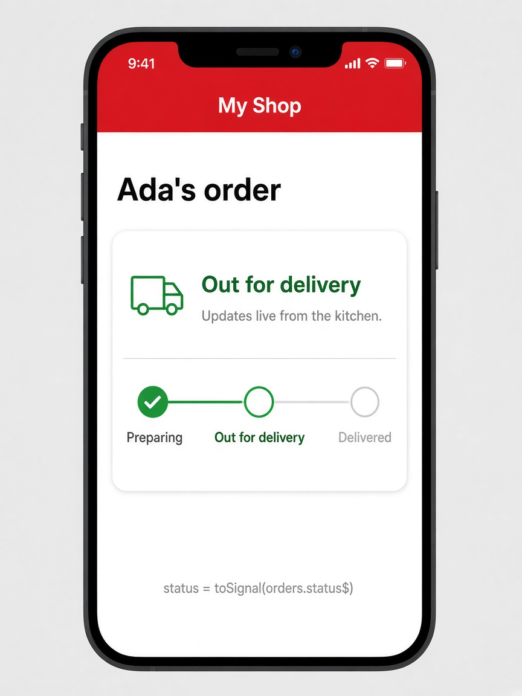

# toSignal(): Observables into signals

Today's tip is **toSignal()**. Plenty of Angular APIs still speak Observables — `HttpClient`, router events, your own RxJS services — while modern templates prefer signals. `toSignal()` is the bridge: hand it an Observable and you get a signal that stays in sync as values arrive, so you can write `{{ status() }}` with no `subscribe` and no manual cleanup.

Pass an `initialValue` so the signal has something before the first emission. Use `{ requireSync: true }` when the source already has a current value, like a `BehaviorSubject`. The older pattern was `subscribe` in `ngOnInit` and assigning to a plain field; `toSignal()` does that wiring for you and unsubscribes when the component is destroyed.

```ts
// order-tracker.ts
import { Component, inject } from '@angular/core';
import { toSignal } from '@angular/core/rxjs-interop';
import { OrderService } from './order.service';

@Component({
  selector: 'app-order-tracker',
  template: `
    <h2>Ada's order</h2>
    <p class="status">{{ status() }}</p>
    <p class="hint">Updates live from the kitchen</p>
  `,
})
export class OrderTracker {
  private orders = inject(OrderService);
  // orders.status$ is Observable<string>
  status = toSignal(this.orders.status$, {
    initialValue: 'Preparing…',
  });
}
```

## On screen

You see a "My Shop" phone with "Ada's order". A status card shows a delivery truck and **Out for delivery**, plus the helper line "Updates live from the kitchen". A three-step track marks Preparing done, Out for delivery active, and Delivered still ahead. When `OrderService.status$` emits a new string, `status()` updates and the card text flips — no subscribe in the component.


