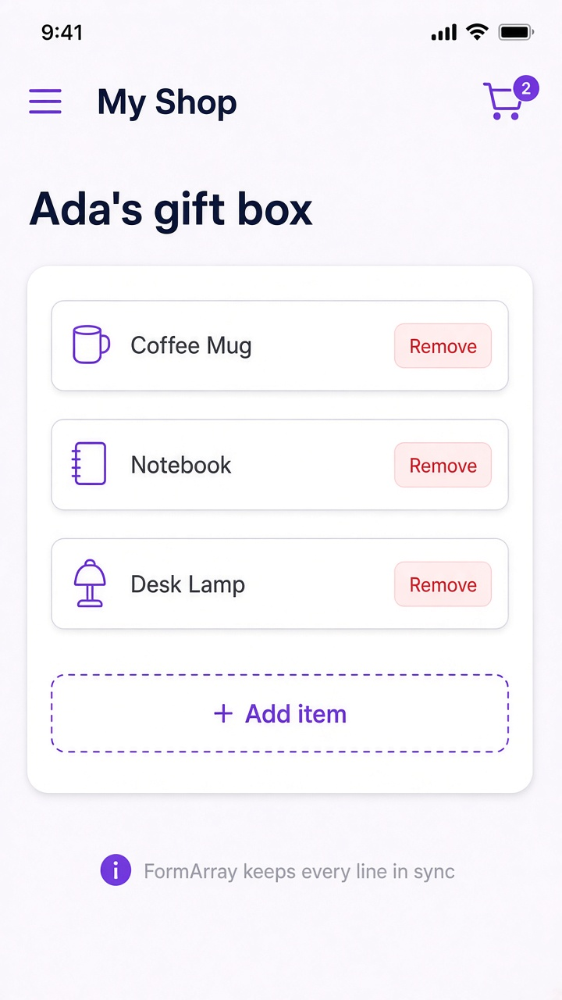

# FormArray: dynamic lists of controls

Today's tip is **FormArray**. A `FormGroup` is great when the fields are fixed — email, name, password — but gift boxes, guest lists, and cart line items grow and shrink. Reach for `FormArray`: an ordered list of controls (or nested groups) you can `push`, `removeAt`, and read as one value. Pair it with `@for` over `items.controls`, bind each row with `[formControlName]="i"` inside a `formArrayName`, and the whole list stays in the reactive forms tree.

Prefer `FormArray` when the count changes at runtime; stick with `FormGroup` for a known shape. Older templates looped with `*ngFor="let c of items.controls; let i = index"` — `@for` with `track $index` is the modern built-in control flow for the same idea.

```ts
// gift-box.ts
import { Component } from '@angular/core';
import {
  FormArray,
  FormControl,
  FormGroup,
  ReactiveFormsModule,
} from '@angular/forms';

@Component({
  selector: 'app-gift-box',
  imports: [ReactiveFormsModule],
  template: `
    <h2>Ada's gift box</h2>
    <form [formGroup]="box">
      <div formArrayName="items">
        @for (ctrl of items.controls; track $index; let i = $index) {
          <div class="row">
            <input [formControlName]="i" placeholder="Item name" />
            <button type="button" (click)="remove(i)">Remove</button>
          </div>
        }
      </div>
      <button type="button" (click)="add()">+ Add item</button>
    </form>
  `,
})
export class GiftBox {
  box = new FormGroup({
    items: new FormArray([
      new FormControl('Coffee Mug'),
      new FormControl('Notebook'),
      new FormControl('Desk Lamp'),
    ]),
  });

  get items() {
    return this.box.controls.items;
  }

  add() {
    this.items.push(new FormControl(''));
  }

  remove(i: number) {
    this.items.removeAt(i);
  }
}
```

## On screen

You see a "My Shop" phone on **Ada's gift box**. A card lists Coffee Mug, Notebook, and Desk Lamp, each with a Remove control, plus a dashed **+ Add item** button. Tapping Add pushes another empty `FormControl` onto the array; Remove calls `removeAt(i)`. `box.value.items` is always the current string list — no separate array to keep in sync by hand.


