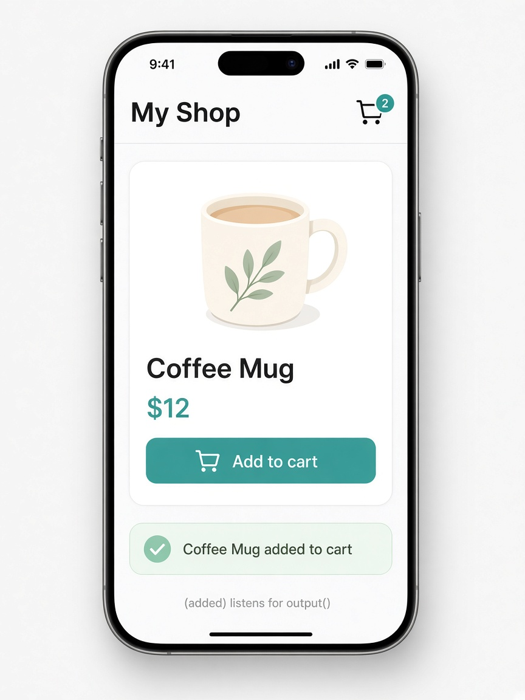

# output(): typed events from child to parent

Today's tip is **`output()`**. When a child needs to tell its parent something happened — add to cart, close a dialog, pick a size — declare a typed emitter with `output<T>()` and call `.emit(value)`. In the parent template you listen the same way you always have: `(added)="onAdded($event)"`. No `@Output()` decorator, no `EventEmitter` import, and the payload type rides on the function.

Use `output()` for one-way child → parent events. Prefer `model()` when the same value should flow both ways. The older form was `@Output() added = new EventEmitter<string>()`; `output()` is the signal-era replacement and pairs cleanly with `input()`.

```ts
// product-card.ts
import { Component, input, output } from '@angular/core';

@Component({
  selector: 'app-product-card',
  template: `
    <article class="card">
      <h3>{{ name() }}</h3>
      <p class="price">\${{ price() }}</p>
      <button type="button" (click)="added.emit(name())">
        Add to cart
      </button>
    </article>
  `,
})
export class ProductCard {
  name = input.required<string>();
  price = input.required<number>();
  added = output<string>();
}
```

```html
<!-- parent: My Shop -->
<app-product-card
  name="Coffee Mug"
  [price]="12"
  (added)="onAdded($event)"
/>
@if (lastAdded()) {
  <p class="toast">{{ lastAdded() }} added to cart</p>
}
```

```ts
// parent class
lastAdded = signal<string | null>(null);

onAdded(name: string) {
  this.lastAdded.set(name);
}
```

## On screen

You see a "My Shop" phone with a **Coffee Mug** card ($12) and a teal **Add to cart** button. Tapping it fires `added.emit(name())`; the parent’s `(added)` handler sets `lastAdded`, and a green toast reads **Coffee Mug added to cart**. The footer hint notes that `(added)` listens for `output()`.


