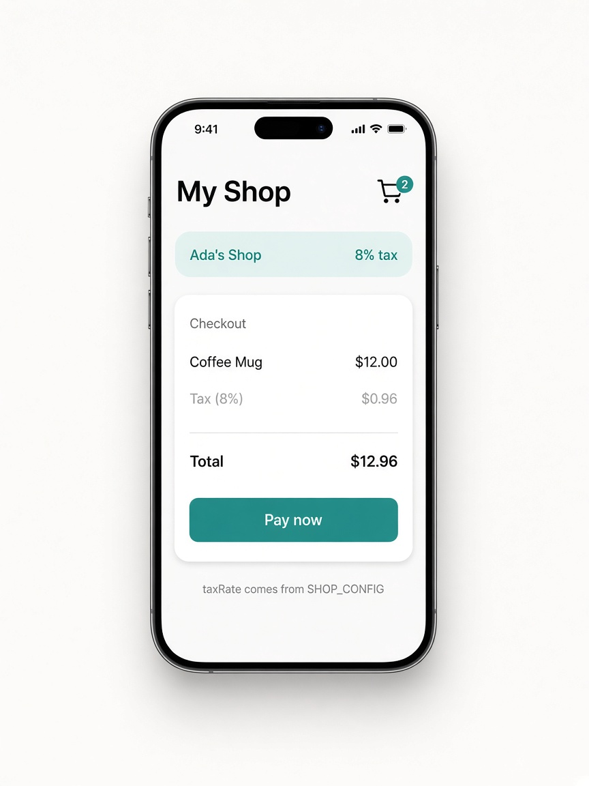

# InjectionToken: provide config that isn't a class

Today's tip is **`InjectionToken`**. When you want to inject something that isn't a class — a config object, an API URL, a tax rate — TypeScript's type is gone by the time Angular runs, so there's nothing to look up. Create a token with `new InjectionToken<ShopConfig>('SHOP_CONFIG')`, provide a value once in your app config with `{ provide: SHOP_CONFIG, useValue: { ... } }`, and read it in any component with `inject(SHOP_CONFIG)`.

The string `'SHOP_CONFIG'` is only a debug label; Angular identifies the token by object reference, so export one instance and reuse it. The older constructor form was `constructor(@Inject(SHOP_CONFIG) config: ShopConfig)`. You can also attach a default factory: `new InjectionToken<ShopConfig>('SHOP_CONFIG', { factory: () => ({ name: "Ada's Shop", taxRate: 0.08 }) })`, which skips the `providers` entry. Reach for `useFactory` instead of `useValue` when the value itself needs other injected dependencies.

```ts
// shop-config.ts
import { InjectionToken } from '@angular/core';

export interface ShopConfig {
  name: string;
  taxRate: number;
}

export const SHOP_CONFIG = new InjectionToken<ShopConfig>('SHOP_CONFIG');
```

```ts
// app.config.ts
providers: [
  {
    provide: SHOP_CONFIG,
    useValue: { name: "Ada's Shop", taxRate: 0.08 },
  },
]
```

```ts
// checkout.ts
import { Component, inject } from '@angular/core';
import { SHOP_CONFIG } from './shop-config';

@Component({
  selector: 'app-checkout',
  template: `
    <p class="banner">{{ config.name }} · {{ taxPercent }}% tax</p>
    <article class="card">
      <h2>Checkout</h2>
      <p>Coffee Mug \${{ price }}</p>
      <p>Tax ({{ taxPercent }}%) \${{ tax }}</p>
      <p class="total">Total \${{ total }}</p>
      <button type="button">Pay now</button>
    </article>
  `,
})
export class Checkout {
  config = inject(SHOP_CONFIG);
  price = 12;
  taxPercent = Math.round(this.config.taxRate * 100);
  tax = this.price * this.config.taxRate;
  total = this.price + this.tax;
}
```

## On screen

You see a "My Shop" phone with a teal banner reading **Ada's Shop** and **8% tax** — both values come from `SHOP_CONFIG`. The checkout card lists Coffee Mug $12.00, Tax (8%) $0.96, and Total **$12.96**, with a teal **Pay now** button. The footer hint notes that `taxRate` comes from `SHOP_CONFIG`.


