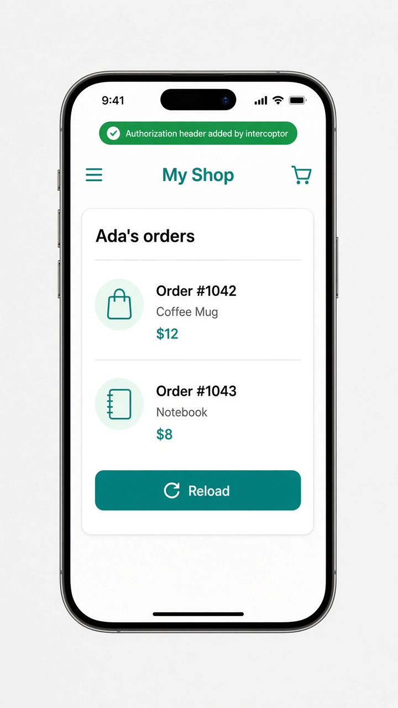

# HTTP interceptors: change every request in one place

Today's tip is the **HTTP interceptor**. Say every call to your API needs an `Authorization` header. Instead of adding it in each service, write one small function that sees every outgoing request and register it once. In modern Angular that's a plain function of type `HttpInterceptorFn`, registered with `provideHttpClient(withInterceptors([...]))`.

Requests are immutable, so you `clone()` the request with the changes and pass it to `next()`. The older form was a class implementing `HttpInterceptor`, provided with the `HTTP_INTERCEPTORS` token. Functional interceptors can also use `inject()`, so reading a token from a service is easy. Interceptors run in the order you list them, and they can touch responses too, by piping the result of `next(req)`.

```ts
// auth.interceptor.ts
import { HttpInterceptorFn } from '@angular/common/http';

export const authInterceptor: HttpInterceptorFn = (req, next) => {
  const authed = req.clone({
    setHeaders: { Authorization: 'Bearer demo-token' },
  });
  return next(authed);
};
```

```ts
// app.config.ts
import { provideHttpClient, withInterceptors } from '@angular/common/http';

providers: [
  provideHttpClient(withInterceptors([authInterceptor])),
]
```

## On screen

You see a "My Shop" phone screen with a green badge at the top reading "Authorization header added by interceptor". Below it, an "Ada's orders" card lists Order #1042 Coffee Mug $12 and Order #1043 Notebook $8, with a teal Reload button. Every Reload sends a request that automatically carries the header.


