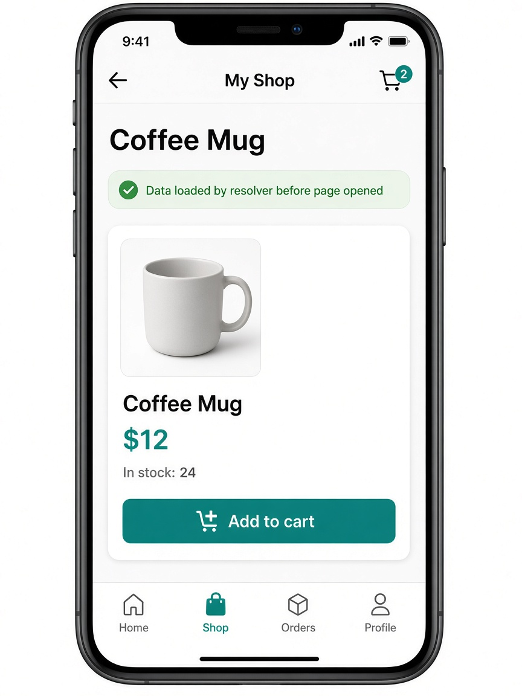

# Route resolvers: load data before the page opens

Today's tip is the **route resolver**. Sometimes a page makes no sense without its data, and you'd rather not show a half-empty screen. A resolver is a small function that runs during navigation, fetches what the page needs, and only then lets the route activate. In modern Angular it's a plain function of type `ResolveFn<T>`, attached to the route with `resolve`.

The resolved value shows up on the component as an input when you use `withComponentInputBinding()`, so the component just declares `product = input.required<Product>()`. The older way was a class implementing `Resolve<T>` and reading `ActivatedRoute.data`. Resolvers can use `inject()`, and if one returns an observable that never completes the navigation will hang, so keep them short. For data that can load later, `@defer` or `resource()` is often a nicer fit.

```ts
// product.resolver.ts
import { inject } from '@angular/core';
import { ResolveFn } from '@angular/router';

export const productResolver: ResolveFn<Product> = (route) =>
  inject(ProductService).get(route.paramMap.get('id')!);
```

```ts
// app.routes.ts
{ path: 'products/:id', component: ProductPage, resolve: { product: productResolver } }

// product-page.ts
product = input.required<Product>();
```

## On screen

A "My Shop" phone screen with a green badge reading "Data loaded by resolver before page opened". Below it a Coffee Mug card shows $12, "In stock: 24" and a teal "Add to cart" button, fully filled in the moment the page appears.


