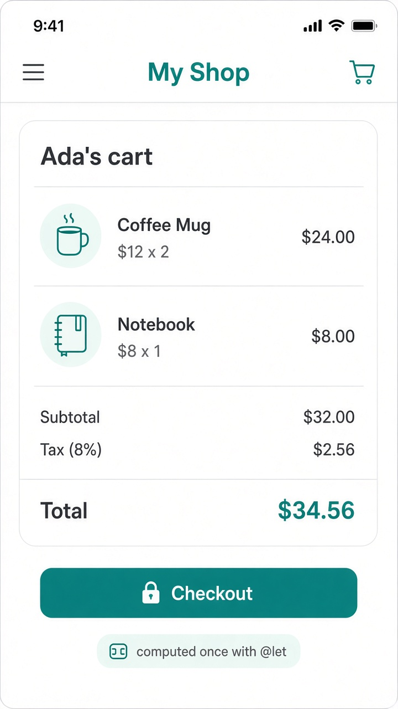

# @let: name a value once in your template

Today's tip is the **`@let` declaration**. Ever written the same expression three times in a template, like `subtotal() * taxRate()`? `@let` lets you give a value a name right inside the template and reuse it below. It's perfect for small, view-only calculations, and for unwrapping an async value once instead of repeating `| async` everywhere.

A `@let` variable is read-only and lives in the template scope where it's declared (it's visible after the line it's written on, in that block and its children). Signals are read as usual, so `@let` re-evaluates when they change. Keep real business logic in the class or in `computed()`; use `@let` for tidy template-only helpers. Before `@let`, people reached for `*ngIf="x as y"` tricks or extra component getters.

```html
@let subtotal = price() * qty();
@let tax = subtotal * 0.08;

<p>Subtotal {{ subtotal | currency }}</p>
<p>Tax (8%) {{ tax | currency }}</p>
<p><strong>Total {{ subtotal + tax | currency }}</strong></p>
```

```html
@let user = user$ | async;
@if (user) { <h2>Hi, {{ user.name }}</h2> }
```

## On screen

A "My Shop" phone screen with "Ada's cart": Coffee Mug $12 x 2 ($24.00) and Notebook $8 x 1 ($8.00), then Subtotal $32.00, Tax (8%) $2.56, and a bold teal Total $34.56. A teal Checkout button sits below with a small chip reading "computed once with @let".


