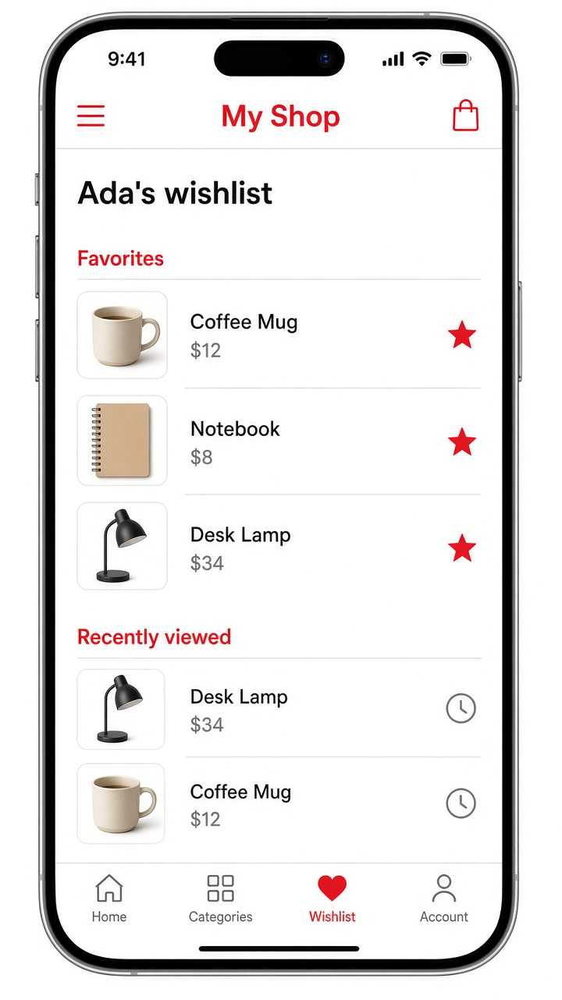

# ng-template and ngTemplateOutlet: write the markup once

Ever copy-pasted the same row markup into two lists? Angular lets you define a chunk of markup once with `<ng-template>` and stamp it out anywhere with `ngTemplateOutlet`. Think of the template as a cookie cutter: you pass it data through `context`, and each place you use it gets its own cookie.

Inside the template, `let-item` receives the value you passed. The older way was copying the markup, or looping with `*ngFor` around the outlet; today `@for` does the loop and the shared template stays the same.

```ts
import { Component } from '@angular/core';
import { NgTemplateOutlet } from '@angular/common';

@Component({
  selector: 'app-wishlist',
  imports: [NgTemplateOutlet],
  template: `
    <ng-template #row let-item let-icon="icon">
      <li>{{ icon }} {{ item.name }} – \${{ item.price }}</li>
    </ng-template>

    <h2>Favorites</h2>
    <ul>
      @for (p of favorites; track p.name) {
        <ng-container *ngTemplateOutlet="row; context: { $implicit: p, icon: '★' }"></ng-container>
      }
    </ul>

    <h2>Recently viewed</h2>
    <ul>
      @for (p of recent; track p.name) {
        <ng-container *ngTemplateOutlet="row; context: { $implicit: p, icon: '🕒' }"></ng-container>
      }
    </ul>
  `,
})
export class Wishlist {
  favorites = [
    { name: 'Coffee Mug', price: 12 },
    { name: 'Notebook', price: 8 },
    { name: 'Desk Lamp', price: 34 },
  ];
  recent = [
    { name: 'Desk Lamp', price: 34 },
    { name: 'Coffee Mug', price: 12 },
  ];
}
```

## On screen
"My Shop" shows "Ada's wishlist" with a Favorites section (Coffee Mug $12, Notebook $8, Desk Lamp $34, each with a star) and a Recently viewed section (Desk Lamp $34, Coffee Mug $12, each with a clock). Both lists use the exact same row template.


