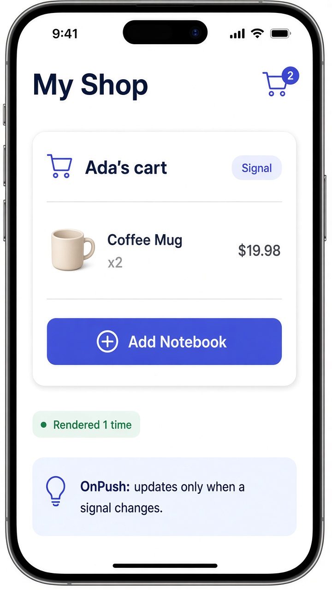

# OnPush change detection: only re-render when something changed

Ever wondered how Angular decides when to refresh the screen? By default it re-checks every component after any event. With `ChangeDetectionStrategy.OnPush`, a component is only checked when an input changes, an event fires inside it, or a signal it reads changes. It's like a doorbell instead of knocking on every door.

Signals and OnPush are a great pair: read a signal in the template and Angular knows exactly when to update. The older habit was mutating objects and relying on default checking; with OnPush, replace values instead of mutating them.

```ts
import { ChangeDetectionStrategy, Component, signal } from '@angular/core';

@Component({
  selector: 'app-cart',
  changeDetection: ChangeDetectionStrategy.OnPush,
  template: `
    <h2>Ada's cart</h2>
    @for (item of items(); track $index) {
      <p>{{ item }}</p>
    }
    <button (click)="add()">Add Notebook</button>
  `,
})
export class Cart {
  items = signal(['Coffee Mug x2']);
  add() { this.items.update(list => [...list, 'Notebook']); }
}
```

## On screen
A My Shop screen with an "Ada's cart" card listing Coffee Mug x2 and an "Add Notebook" button. A green "Rendered 1 time" label and a tip: "OnPush: updates only when a signal changes." Tapping the button adds a Notebook row.


