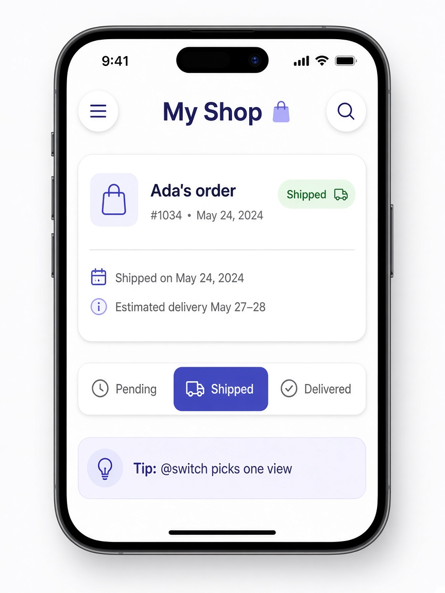

# @switch: pick one view from many

Sometimes a screen has several possible states and you want to show exactly one. Angular's built-in `@switch` control flow does that: it compares a value to each `@case` and renders the match, with `@default` as the fallback. It reads like plain TypeScript, with no extra directives to import.

Pair it with a signal and the view updates whenever the value changes. The older way was `*ngSwitch` with `*ngSwitchCase` and `*ngSwitchDefault` (needs NgSwitch imports); you'll still see it in older code.

```ts
import { Component, signal } from '@angular/core';

@Component({
  selector: 'app-order-status',
  template: `
    <h2>Ada's order</h2>
    @switch (status()) {
      @case ('pending') { <p>Preparing your order…</p> }
      @case ('shipped') { <p>On the way 🚚</p> }
      @case ('delivered') { <p>Delivered!</p> }
      @default { <p>Unknown status</p> }
    }
    <button (click)="status.set('shipped')">Shipped</button>
  `,
})
export class OrderStatus {
  status = signal<'pending' | 'shipped' | 'delivered'>('pending');
}
```

## On screen
A My Shop screen with an "Ada's order" card showing a green "Shipped" badge and a truck icon. Three buttons (Pending, Shipped, Delivered) sit below with Shipped selected; tapping another swaps the card to that view.


