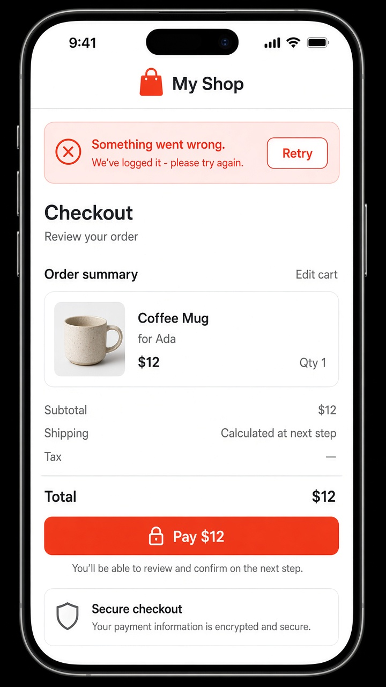

# Global Error Handling with ErrorHandler

Every app eventually throws an error you didn't plan for. Angular's **ErrorHandler** is the one place where uncaught errors land, so you can log them and show a friendly message instead of a silent failure.

Write a class that implements `ErrorHandler`, then swap it in with `{ provide: ErrorHandler, useClass: ... }` in your app config. Older NgModule apps did the same in the `providers` array of `AppModule`.

```ts
import { ErrorHandler, Injectable, inject, signal } from '@angular/core';

@Injectable({ providedIn: 'root' })
export class ErrorState { message = signal<string | null>(null); }

@Injectable()
export class ShopErrorHandler implements ErrorHandler {
  private state = inject(ErrorState);
  handleError(error: unknown) {
    console.error('Logged:', error);
    this.state.message.set("Something went wrong. We've logged it - please try again.");
  }
}

// app.config.ts
providers: [{ provide: ErrorHandler, useClass: ShopErrorHandler }]
```

```html
<!-- in any component: state = inject(ErrorState); -->
@if (state.message(); as msg) { <div class="banner">{{ msg }}</div> }
```

## On screen
Ada's My Shop checkout shows a red banner "Something went wrong. We've logged it - please try again." The mockup adds a Retry button and places the banner above a Coffee Mug $12 card.


