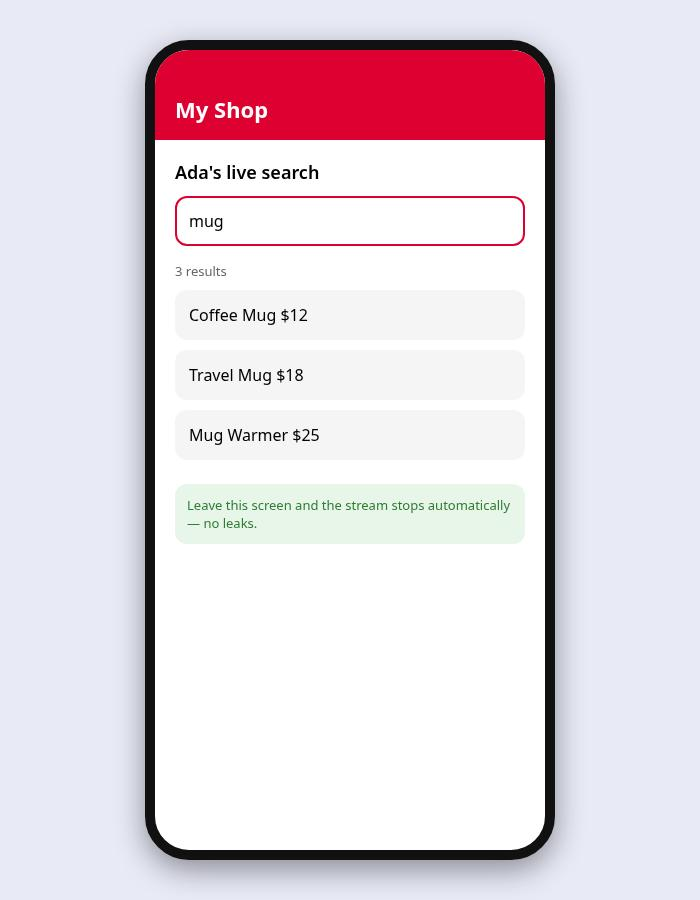

# takeUntilDestroyed: Clean Up Subscriptions Automatically

Today's tip is **`takeUntilDestroyed`**, a small RxJS helper from `@angular/core/rxjs-interop`. When you subscribe to a stream in a component, it keeps running even after the component leaves the screen unless you stop it. Add `.pipe(takeUntilDestroyed())` and Angular ends the subscription automatically when the component is destroyed, preventing memory leaks.

Call it in an injection context, such as a field initializer or the constructor, and it finds the component's `DestroyRef` on its own. Outside that context, pass one in with `takeUntilDestroyed(this.destroyRef)`. The older way is a `destroy$` `Subject` paired with `takeUntil(this.destroy$)` and an `ngOnDestroy` hook calling `next()` and `complete()`. It works, just with more boilerplate. For values you only read in a template, `toSignal()` or the `async` pipe also clean up for you.

```ts
import { Component, inject, signal } from '@angular/core';
import { takeUntilDestroyed } from '@angular/core/rxjs-interop';
import { ShopService } from './shop.service';

@Component({
  selector: 'live-search',
  template: `<p>{{ results().length }} results</p>`,
})
export class LiveSearch {
  private shop = inject(ShopService);
  results = signal<string[]>([]);

  constructor() {
    this.shop.results$
      .pipe(takeUntilDestroyed())
      .subscribe(r => this.results.set(r));
  }
}
```

## On screen
When the stream emits three matches, the template updates to show "3 results", and navigating away ends the subscription on its own. The mockup puts this inside Ada's live search on a "My Shop" phone, adding a search box with "mug", three result cards (Coffee Mug $12, Travel Mug $18, and Mug Warmer $25), and a green note reminding you that leaving the screen stops the stream.


