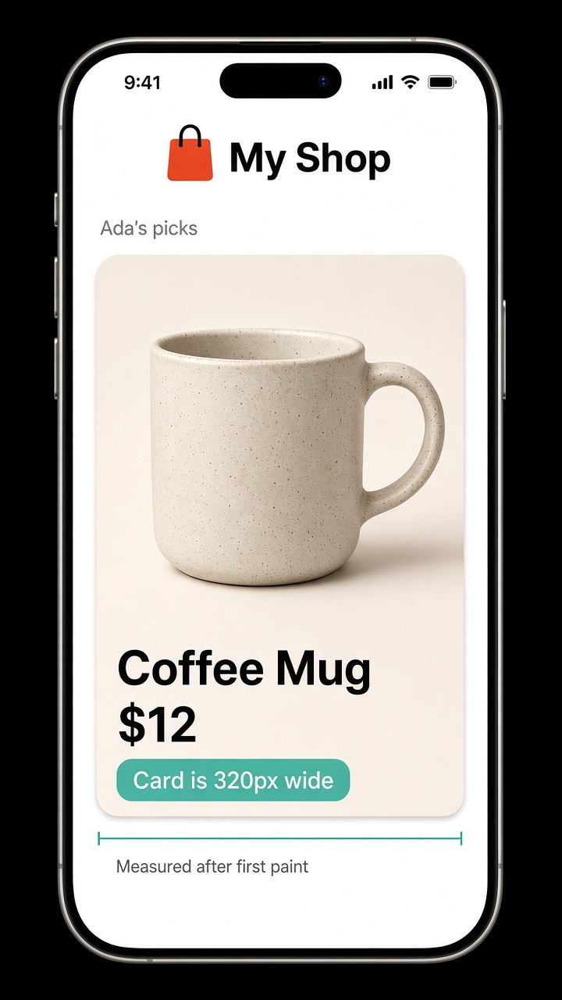

# afterNextRender: Measure the DOM After Angular Paints

Today's tip is **afterNextRender**, a function that runs your code once, after Angular has painted the next view to the screen. That's the moment the DOM is actually there, so you can safely measure an element's size, focus an input, or hand a canvas to a chart library. Call it in an injection context, such as the constructor. For a DOM read like measuring width, pass a `read` callback so Angular can schedule it after any writes and avoid layout thrashing.

If you need the work to run after every render, use `afterEveryRender` instead. These hooks run only in the browser, not during server-side rendering. The older way is the `ngAfterViewInit` lifecycle hook, which still works and you'll see it in lots of code.

```ts
import { Component, ElementRef, afterNextRender, inject, signal } from '@angular/core';

@Component({
  selector: 'product-card',
  template: `
    <h3>Coffee Mug</h3>
    <p>$12</p>
    @if (width()) {
      <p>Card is {{ width() }}px wide</p>
    }
  `,
})
export class ProductCard {
  private host = inject(ElementRef);
  width = signal(0);

  constructor() {
    afterNextRender({
      read: () => {
        this.width.set(this.host.nativeElement.offsetWidth);
      },
    });
  }
}
```

## On screen
A Coffee Mug card shows the heading "Coffee Mug" and the price $12. After Angular paints the view, `afterNextRender` measures the card and the line "Card is 320px wide" appears. The mockup places this card in Ada's My Shop, adds the "Ada's picks" label and a mug photo, draws a teal width line under the card, and includes a small "Measured after first paint" note.


