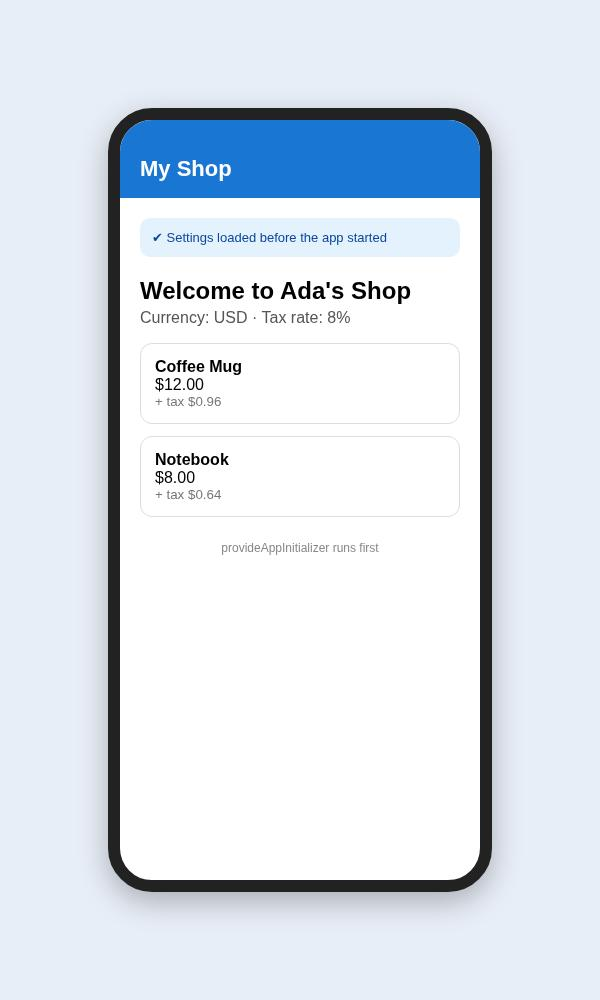

# provideAppInitializer: Load Settings Before the App Starts

Today's tip is **provideAppInitializer**, a way to run setup code before your app shows its first screen. Think of loading shop settings, like currency and tax rate, so every component can rely on them being ready. Angular waits for the function to finish; if it returns a Promise (or Observable), the app holds until it resolves. Inside it you can use `inject()`.

Register it in your app config. The older way is the `APP_INITIALIZER` token with `useFactory`, `deps`, and `multi: true`, which you'll still see in many projects. Keep initializers quick, since users stare at a blank page while they run.

```ts
import { ApplicationConfig, inject, provideAppInitializer } from '@angular/core';
import { SettingsService } from './settings.service';

export const appConfig: ApplicationConfig = {
  providers: [
    provideAppInitializer(async () => {
      const settings = inject(SettingsService);
      await settings.load(); // currency, taxRate
    }),
  ],
};
```

## On screen
Nothing new appears from this code by itself. The difference is that the app's first screen only shows up after `settings.load()` finishes, so components never render with missing settings. The mockup shows that moment in Ada's My Shop: a "Settings loaded before the app started" banner, "Currency: USD · Tax rate: 8%", and Coffee Mug $12.00 (+ tax $0.96) and Notebook $8.00 (+ tax $0.64) cards.



