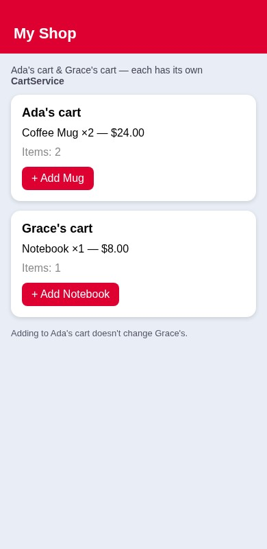

# Component-Level Providers: One Service Instance Per Component

Today's tip is **component-level providers**. Normally a service with `providedIn: 'root'` is a single shared instance for the whole app. But if you list the service in a component's `providers` array, Angular creates a fresh instance for each copy of that component, and it is destroyed along with it. That's perfect for state that belongs to one widget, like a cart panel.

Here Ada's and Grace's carts both use the same `CartPanel` component, yet each has its own `CartService`. Children of the component can `inject()` the same instance too. Remember: leave off `providedIn: 'root'` on such services, or the root one may be used by mistake. The older style is the same `providers` array, with constructor injection.

```ts
import { Component, Injectable, inject, signal } from '@angular/core';

@Injectable() // no providedIn: 'root'
export class CartService {
  items = signal<string[]>([]);
  add(name: string) { this.items.update(l => [...l, name]); }
}

@Component({
  selector: 'app-cart-panel',
  providers: [CartService], // new instance per panel
  template: `
    <p>Items: {{ cart.items().length }}</p>
    <button (click)="cart.add('Coffee Mug')">+ Add</button>`,
})
export class CartPanel {
  cart = inject(CartService);
}
```

## On screen
Each cart panel shows "Items: N" and a + Add button. Because each panel provides its own `CartService`, tapping + Add in one only changes that panel's count. The mockup places two of these panels in My Shop: "Ada's cart" with Coffee Mug ×2 — $24.00 and Items: 2, "Grace's cart" with Notebook ×1 — $8.00 and Items: 1, plus a note that adding to Ada's cart doesn't change Grace's.


