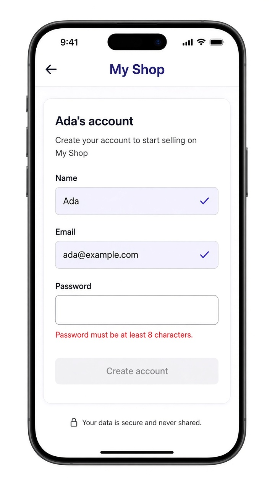

# Typed Reactive Forms with NonNullableFormBuilder

Today's tip is **typed reactive forms**. Since Angular 14, `FormControl` and `FormGroup` know their value types, so `form.value.email` is a string and typos get caught at compile time. The catch: a plain control can become `null` after `reset()`. Inject `NonNullableFormBuilder` and every control resets to its initial value instead, keeping your types clean.

Here Ada's sign-up form uses `inject(NonNullableFormBuilder)`. Validators work the same, and `getRawValue()` returns a fully typed object. The older style is `FormBuilder` with looser types (or `UntypedFormGroup`), which you'll still see in older code.

```ts
import { Component, inject } from '@angular/core';
import { NonNullableFormBuilder, ReactiveFormsModule, Validators } from '@angular/forms';

@Component({
  selector: 'app-signup',
  imports: [ReactiveFormsModule],
  template: `
    <form [formGroup]="form" (ngSubmit)="submit()">
      <input formControlName="name" />
      <input formControlName="email" />
      <input type="password" formControlName="password" />
      @if (form.controls.password.invalid) {
        <p>Password must be at least 8 characters</p>
      }
      <button [disabled]="form.invalid">Create account</button>
    </form>`,
})
export class Signup {
  private fb = inject(NonNullableFormBuilder);
  form = this.fb.group({
    name: ['Ada', Validators.required],
    email: ['ada@example.com', [Validators.required, Validators.email]],
    password: ['', [Validators.required, Validators.minLength(8)]],
  });
  submit() {
    const v = this.form.getRawValue(); // typed: { name: string; email: string; password: string }
    this.form.reset(); // back to initial values, never null
  }
}
```

## On screen
The sign-up form shows name and email filled in as "Ada" and "ada@example.com", an empty password field, the red hint "Password must be at least 8 characters" because the password is invalid, and a disabled Create account button. The mockup places this in a My Shop phone as "Ada's account", adds Name/Email/Password labels, checkmarks on the valid fields, a subtitle, and a lock note that your data is never shared.


