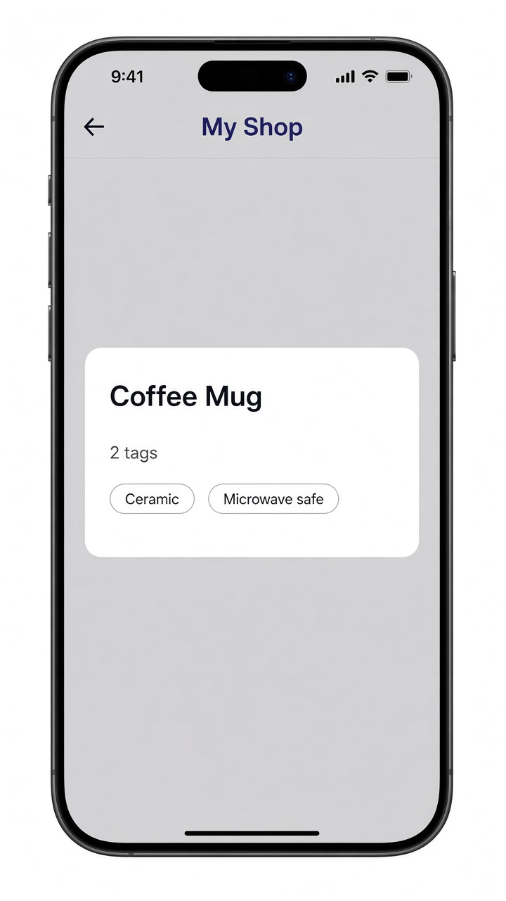

# contentChild and contentChildren

Today's tip is **`contentChild` and `contentChildren`**. These signal queries let a component reach into the content you project with `<ng-content>`, not just its own template. `contentChildren('tag')` collects every projected element marked `#tag`, and you read that list as a signal. That's handy for a count, or for treating projected items as part of the component's state. Call them as field initializers, the same way you would `viewChild()` for elements in your own template. The older style is the `@ContentChild` and `@ContentChildren` decorators, which give you a `QueryList` you usually read in `ngAfterContentInit`.

```ts
import { Component, contentChildren, input } from '@angular/core';

@Component({
  selector: 'app-product-card',
  template: `
    <h3>{{ name() }}</h3>
    <p>{{ tags().length }} tags</p>
    <ng-content />
  `,
})
export class ProductCard {
  name = input.required<string>();
  tags = contentChildren('tag');
}
```

```html
<app-product-card name="Coffee Mug">
  <span #tag>Ceramic</span>
  <span #tag>Microwave safe</span>
</app-product-card>
```

## On screen
A Coffee Mug card shows the heading, the line "2 tags", and the two projected labels, Ceramic and Microwave safe. The mockup places this card in a My Shop phone.


