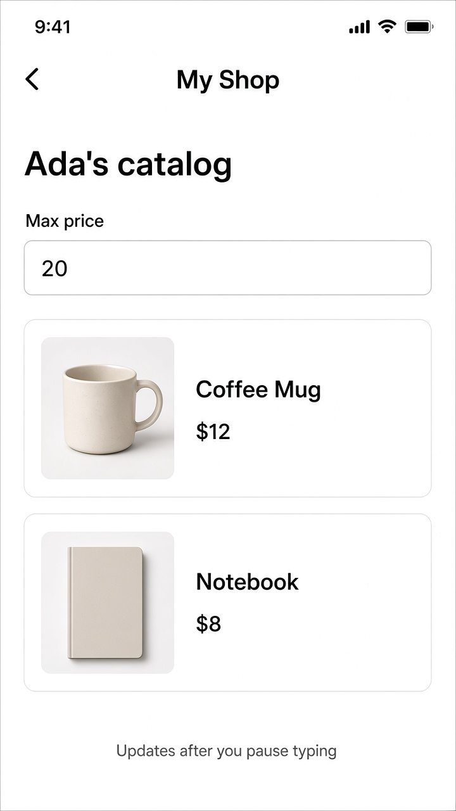

# toObservable(): Turn a Signal into an RxJS Stream

Happy Thanksgiving! Today's tip is **`toObservable()`**. It turns a signal into an RxJS observable, which is the bridge you want when your state already lives in a signal but you need an RxJS operator — like `debounceTime` — before you react. Import it from `@angular/core/rxjs-interop`, pass the signal in, and pipe or subscribe as usual. Add `takeUntilDestroyed()` so the subscription stops when the component goes away. The older style is to keep that value in a `BehaviorSubject` or a `FormControl` and subscribe to it directly.

Here Ada's catalog keeps `max` as a signal. `toObservable(this.max)` waits 300ms after the last change, then filters the list, so the products don't jump on every keystroke.

```ts
import { Component, signal } from '@angular/core';
import { takeUntilDestroyed, toObservable } from '@angular/core/rxjs-interop';
import { debounceTime } from 'rxjs';

type Item = { name: string; price: number };

@Component({
  selector: 'app-catalog',
  template: `
    <label>
      Max price
      <input type="number" [value]="max()" (input)="onInput($event)" />
    </label>
    @for (item of visible(); track item.name) {
      <p>{{ item.name }} — {{ '$' + item.price }}</p>
    }
  `,
})
export class Catalog {
  private catalog: Item[] = [
    { name: 'Coffee Mug', price: 12 },
    { name: 'Notebook', price: 8 },
    { name: 'Desk Lamp', price: 34 },
  ];
  max = signal(20);
  visible = signal<Item[]>(this.catalog.filter(i => i.price <= 20));

  constructor() {
    toObservable(this.max)
      .pipe(debounceTime(300), takeUntilDestroyed())
      .subscribe(max =>
        this.visible.set(this.catalog.filter(i => i.price <= max)),
      );
  }

  onInput(event: Event) {
    this.max.set(Number((event.target as HTMLInputElement).value));
  }
}
```

## On screen
A max price field set to 20, and the list shows Coffee Mug — $12 and Notebook — $8. Desk Lamp at $34 stays hidden because it is over the limit. The mockup places this in a My Shop phone as "Ada's catalog", shows the two items as product cards with photos, and adds a note that the list updates after you pause typing.


