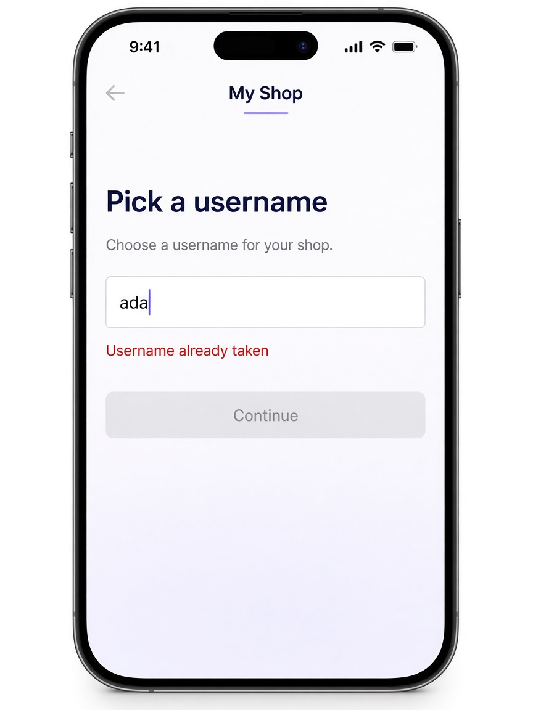

# Async validators: check a username with the server

Today's tip is **async validators**. Some rules can't be checked in the browser. "Is this username taken?" needs the server. An async validator returns an Observable (or Promise) that emits `null` when valid or an error object when not. While it runs, the control's status is `PENDING`. Put them in the `asyncValidators` option of a `FormControl`; they only run once the sync validators pass. The `timer(300)` here acts like a debounce, because Angular unsubscribes when the value changes, so the server isn't called on every keystroke. You can also use `updateOn: 'blur'`. Call `usernameFree()` in an injection context, such as a field initializer, so `inject()` works. The older style is a class implementing `AsyncValidator`, registered with `NG_ASYNC_VALIDATORS`.

```ts
import { Component, inject } from '@angular/core';
import { AbstractControl, AsyncValidatorFn, FormControl, ReactiveFormsModule, Validators } from '@angular/forms';
import { map, switchMap, timer } from 'rxjs';
import { UserService } from './user.service';

function usernameFree(): AsyncValidatorFn {
  const users = inject(UserService);
  return (c: AbstractControl) =>
    timer(300).pipe(
      switchMap(() => users.isTaken(c.value)),
      map(taken => (taken ? { taken: true } : null)),
    );
}

@Component({
  selector: 'app-pick-username',
  imports: [ReactiveFormsModule],
  template: `
    <input [formControl]="name" />
    @if (name.pending) { <p>Checking…</p> }
    @if (name.hasError('taken')) { <p>Username already taken</p> }
    <button [disabled]="name.invalid || name.pending">Continue</button>
  `,
})
export class PickUsername {
  name = new FormControl('ada', {
    nonNullable: true,
    validators: [Validators.required],
    asyncValidators: [usernameFree()],
  });
}
```

## On screen
The field shows "ada", a red "Username already taken" message appears once the check finishes, and Continue stays disabled because the control is invalid. The mockup places this in a My Shop phone titled "Pick a username" and adds the subtitle "Choose a username for your shop."


