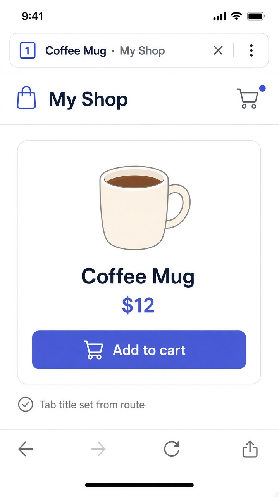

# Route titles: set the browser tab title from the router

Today's tip is **route titles**. Instead of calling the `Title` service by hand in every component, give each route a `title`. The router sets `document.title` for you whenever that route is activated, so the tab, history, and bookmarks always say the right thing. A plain string works for static pages. For dynamic ones, use a `ResolveFn<string>`, which can use `inject()` to look up data. Need a prefix on every title? Provide your own `TitleStrategy` once. The older way was injecting `Title` and calling `setTitle()` in `ngOnInit`, which is easy to forget.

```ts
import { inject } from '@angular/core';
import { Routes } from '@angular/router';
import { Home } from './home';
import { ProductPage } from './product-page';
import { ProductService } from './product.service';

export const routes: Routes = [
  { path: '', component: Home, title: 'My Shop' },
  {
    path: 'product/:id',
    component: ProductPage,
    title: route => inject(ProductService).name(route.paramMap.get('id')!) + ' · My Shop',
  },
];
```

## On screen
A phone browser is on the product route, and the tab title reads "Coffee Mug · My Shop". The mockup shows that tab in a My Shop browser chrome, with a Coffee Mug card at $12, an Add to cart button, and the caption "Tab title set from route". Going back to the home route changes the tab to "My Shop", with no extra code in the components.


